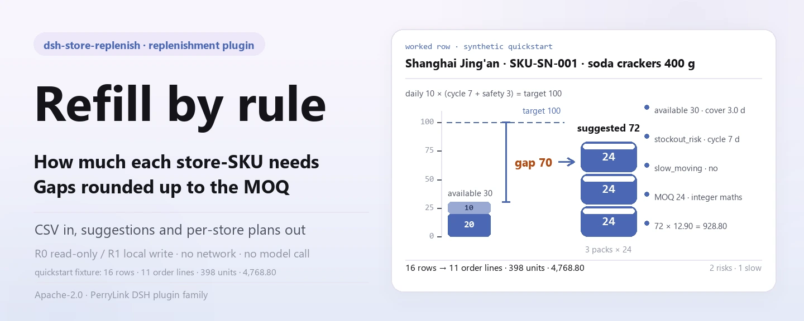

<div align="center">

<picture>
  <source media="(prefers-color-scheme: dark)" srcset="docs/assets/dsh-store-replenish-hero-en-dark.webp">
  
</picture>

# dsh-store-replenish

**Turn a store-SKU sales/inventory CSV into per-SKU replenishment suggestions, per-store replenishment orders and a replenishment CSV.**

A DeepSeek Harness plugin for replenishment maths: compute `daily average × (cycle days + safety days) − stock − in-transit`, round the gap up to the MOQ, and flag slow-moving SKUs and stockout risk along the way. Local only, zero runtime dependencies, no network, no purchase order.

[Install](#three-step-setup) · [Configuration](#configuration) · [FAQ](#faq) · [简体中文](README.md) · [English](README.en.md) · [Español](README.es.md) · [Português](README.pt.md) · [हिन्दी](README.hi.md)

[](LICENSE)
[](#compatibility)
[](https://www.npmjs.com/package/dsh-store-replenish)
[](https://github.com/PerryLink/dsh-store-replenish/actions/workflows/ci.yml)
[](#compatibility)

[](https://github.com/PerryLink/dsh-store-replenish/stargazers)
[](https://www.npmjs.com/package/dsh-store-replenish)
[](https://dshfind.com/plugins/PerryLink/dsh-store-replenish?ref=badge)

```sh
dsh plugin --profile <profile> add dsh-store-replenish
```

</div>

<sub>Community plugin, not affiliated with DeepSeek. Canonical repository: <https://github.com/PerryLink/dsh-store-replenish>. Status: alpha · public/synthetic data only · not GA — no store data, product data or sales evidence, and no production-readiness, procurement or financial claim.</sub>

## What it is

Read a user-named store-SKU sales/inventory CSV and compute one suggested replenishment quantity per store-SKU from a single auditable rule: daily average × (cycle days + safety days) gives the target stock, subtract stock on hand and in-transit, then round the gap up to the MOQ. Aggregate the result into one order per store, and write it out as a local replenishment CSV when you need a file. SKUs whose turnover exceeds 60 days are flagged slow-moving, and so are SKUs whose available stock cannot cover the next replenishment cycle — but ordering, transfers and ERP/POS/WMS integration are all out of scope. It produces a suggestion and a reviewable table, nothing more.

- **Fits:** tens to thousands of store-SKU combinations; fixing one auditable rule for daily average, stock, in-transit, safety days, cycle days and MOQ; per-store SKU counts, total units and estimated amount; deciding replenishment order by stockout risk first; a replenishment list for a store manager, buyer or warehouse to review.
- **Does not fit:** raising purchase orders, transfers or ERP/POS/WMS integration; multi-warehouse, multi-currency, tax or tax-inclusive pricing; promotions, seasons, shelf life, batches or expiry; EOQ, carrying cost, service level or safety-stock optimisation (safety days are an input); reading Excel/PDF/images directly (export CSV first); treating a suggestion as a purchasing commitment.

<picture>
  <source media="(prefers-color-scheme: dark)" srcset="docs/assets/dsh-store-replenish-flow-v5-dark.svg">
  
</picture>

## Three-step setup

1. **Install** (pick one channel):

   ```sh
   # npm channel (recommended, published releases)
   dsh plugin --profile <profile> add dsh-store-replenish
   # git channel (latest main; equivalent to git+https://github.com/PerryLink/dsh-store-replenish.git)
   dsh plugin --profile <profile> add github:PerryLink/dsh-store-replenish
   # tarball channel: pnpm pack in this repo, then
   dsh plugin --profile <profile> add ./dsh-store-replenish-<version>.tgz
   ```

2. **Minimal config**: there are no plugin-level config keys — `cordis.patch.yml` only `insert`s one row, and the defaults work. What you can tune is two environment variables and the tool arguments (see "Configuration").

   ```yaml
   - insert:
       - id: dsh-store-replenish
         name: dsh-store-replenish
   ```

3. **Verify it mounts**:

   ```sh
   dsh --profile <profile> --dump-config | grep dsh-store-replenish
   node samples/quickstart/run.mjs --check
   ```

   The quickstart runs the shipped synthetic sample (2 stores × 8 SKUs) through the whole chain and should end with:

   ```text
   dsh-store-replenish quickstart - synthetic 2 stores x 8 SKUs (not store data)
   30-day window: 16 store-SKU rows, 11 order line(s), 398 unit(s), 4,768.80; 2 stockout risk(s), 1 slow-moving
   golden samples/quickstart/expected/result.json matches
   quickstart ok
   ```

**Uninstall**: `dsh plugin --profile <profile> remove dsh-store-replenish` (or remove the row from the profile patch).

<details>
<summary>Install from the DSH Desktop market</summary>

Every PerryLink plugin is listed in the built-in DSH Desktop market: **Market → Sources → Add source → paste** `https://perrylink-dsh-catalog.perrylink.workers.dev/catalog-source.json` **→ select**. Installation still requires the market's npm identity check and your confirmation.

</details>

## Core capabilities

- **Per-SKU suggestions** — `replenish_suggest` reads the store-SKU CSV and computes each SKU's suggested quantity from daily average, cycle days, safety days, stock, in-transit and MOQ, returning the daily average, cover days, turnover days, target quantity, gap, estimated value and three flags.
- **Per-store orders** — `replenish_plan` aggregates suggestions into one order per store: SKU count, order lines, total units, estimated amount, stockout-risk and slow-moving counts, ranked by stockout risk, with every per-SKU item kept.
- **A reviewable local CSV** — `replenish_export` writes the order as a fixed 13-column CSV under `$DSH_HOME/dsh-store-replenish/exports/` and returns the path, `sha256`, bytes and row counts; only SKUs with a positive suggested quantity are written by default.
- **Slow-moving and stockout flags** — turnover over 60 days sets `slow_moving`; stock + in-transit that cannot cover the next replenishment cycle sets `stockout_risk`; stock already at 0 with demand sets `stockout_now`.
- **Deterministic ordering** — store and SKU order is fully rule-driven (risk → amount → name / SKU), so the same input always yields the same output and can be reviewed or archived.
- **Integer arithmetic** — units are integers and money is integer cents; MOQ rounding uses integer numerator/denominator maths, so an exact multiple is never pushed to the next case by floating-point drift.
- **Local only** — there is no `fetch` / HTTP / DNS / WebSocket call in the source; the demo metadata in `package.json` declares `network: false` and `external: []`.

### Tool surface

Tool names are stable API (kept in English to match runtime output). Read-only tools are **R0**; the local-write tool is **R1**.

| Tool | Purpose | Risk |
|---|---|---|
| `replenish_suggest` | Read the store-SKU CSV and compute each SKU's suggested replenishment quantity from daily average, cycle days, safety days, stock, in-transit and MOQ; flag slow-moving and stockout risk | R0 read-only |
| `replenish_plan` | Aggregate a per-store replenishment order (SKU count, order lines, units, estimated amount, risk counts), ranked by stockout risk | R0 read-only |
| `replenish_export` | Write the replenishment CSV (store/SKU/name/stock/in-transit/daily/cycle/safety/suggested/value/risk/slow/turnover), returning path + sha256 | R1 local write |

### Input

- **Format**: UTF-8 CSV with a header row and comma separators; RFC 4180 quotes, embedded newlines, CRLF and a UTF-8 BOM are supported.
- **Header**: `store,sku,name,sales_qty,stock_qty,in_transit,safety_days,cycle_days,moq,unit_price_cents`. Chinese header aliases are accepted too; `name` is optional and falls back to the SKU; extra columns are ignored.

```text
store,sku,name,sales_qty,stock_qty,in_transit,safety_days,cycle_days,moq,unit_price_cents
门店,SKU,品名,销量,当前库存,在途,安全天数,补货周期天数,起订量,单价分
```

- **Sales window**: `sales_qty` is cumulative demand **inside the declared window** in the same unit as stock. The window is the `window_days` tool argument, default 30.
- **Numbers**: sales, stock, in-transit, safety days, cycle days, MOQ and unit price are non-negative integers; MOQ is at least 1; safety and cycle days are capped at 3650; price is integer **cents**. Negative, fractional, empty or out-of-range values are `E_REPL_QTY`.
- **Store-SKU**: a `(store, SKU)` pair may appear once per file; different stores may carry the same SKU.
- **Size and source**: up to 20 MB per file — split by store or category beyond that. The source is the local CSV the user names; it is read-only and never modified.

### Output

- **`replenish_suggest`**: `{ window_days, source_sha256, totals, items }`. Each SKU carries daily average, cover days, turnover days, target quantity, raw gap, suggested quantity, estimated value and the `slow_moving`, `stockout_risk` and `stockout_now` flags. Items sort deterministically by store, risk, quantity and SKU.
- **`replenish_plan`**: `{ window_days, source_sha256, totals, stores }`. Per store: `sku_count`, `order_lines`, `total_units`, `estimated_value_cents`, risk and slow-moving counts, and `risk_level` (high/medium/low). Stores are ranked by stockout risk and keep every per-SKU item.
- **`replenish_export`**: writes the replenishment order as CSV under `$DSH_HOME/dsh-store-replenish/exports/` with a fixed 13-column header, and returns path, `sha256`, bytes and row counts. Only SKUs with a positive suggested quantity are written by default; `include_zero=true` appends the rest for review.

```text
门店,SKU,品名,当前库存,在途,日均销量,补货周期天数,安全天数,建议补货量,预估金额,缺货风险,滞销,周转天数
```

### Rules

1. Daily average = `sales_qty / window_days`; `window_days` defaults to 30 and accepts 1–3650. It declares what the sales column means; the tool does not fetch history.
2. Target stock = `daily average × (cycle_days + safety_days)`.
3. Gap = `target − stock − in-transit`; in-transit counts as available stock.
4. Suggested quantity = 0 when the gap is ≤ 0, otherwise `ceil(gap / moq) × moq`. MOQ rounding uses integer numerator/denominator math so an exact multiple is never pushed to the next case by floating-point drift.
5. Turnover days = `stock / daily average`; stock > 0 with turnover > 60 days is slow-moving. No sales but stock on hand gives `turnover_days: null` (treated as infinite) and the slow-moving flag; no sales and no stock is not flagged.
6. Stockout risk = `stock + in-transit < daily average × cycle_days`, i.e. available stock cannot cover one replenishment cycle. `stockout_now=true` additionally means stock is 0 with positive demand.
7. Store order: `stockout_now` count desc → stockout-risk count desc → estimated amount desc → store name asc. Risk outranks amount, so a smaller store can rank first.
8. Item order inside a store: `stockout_now` → stockout risk → needs replenishment → slow-moving → other; within a tier, quantity desc then SKU asc.
9. Estimated value = `suggested quantity × unit price cents`; the API returns integer cents and the CSV renders two decimals.
10. `replenish_export` writes only positive suggested quantities; if there is no such row it raises `E_REPL_EMPTY`. With `include_zero=true` every SKU is written, while `order_lines` still counts only positive rows.

### Examples

Paste this line (the `dsh.demo.prompt` shipped in `package.json`):

```text
用这份 2 门店 × 8 SKU 的销售库存表，按 30 天窗口算补货建议，汇总成门店补货单并导出补货 CSV。
```

Or reproduce the bundled sample and compare with the golden file (a real run — the screenshot comes from this command):

```sh
node samples/quickstart/run.mjs --check
```


The sample is 16 synthetic rows (2 stores × 8 SKUs). It contains one slow-moving SKU (Chengdu, hand sanitizer 500 ml, turnover 100 days) and two stockout-risk SKUs (Shanghai, soda crackers 400 g and fresh milk 950 ml). It also covers an exact MOQ multiple (12 → 12), a non-multiple (70 → 72), an exact-zero gap (Shanghai, dry cat food) and a SKU with no sales at all (Chengdu, hand sanitizer). The golden file `samples/quickstart/expected/result.json` is the real stdout of `node samples/quickstart/run.mjs --json`, not hand-written; the screenshot is the real `--check` terminal output, and the command and output hashes are recorded in `screenshots.json`.

*Observed from `src/plugin/tools.ts:159-168` (the `replenish_suggest` render line) and `docs/assets/quickstart.log`*

## Measured data

The public/synthetic acceptance suite is reproduced with `node scripts/gate.mjs` (`scripts/lint.mjs` + `scripts/acceptance.mjs` + every `ACCEPTANCE.csv` row `pass=true`); details live in `ACCEPTANCE.csv`. Current record:

- **Tests**: `node --test test/*.test.mjs` → 121 pass, 0 fail (15 test files).
- **Gates**: `node scripts/lint.mjs` → 9 source files / 15 test files / 121 tests / 16 published entries; `node scripts/gate.mjs` → `gate ok: 16 acceptance rows`.
- **Golden**: `node samples/quickstart/run.mjs --check` → `golden samples/quickstart/expected/result.json matches`.
- **Sample shape**: on the 30-day window, 16 store-SKU rows → 11 order lines, 398 units, 4,768.80 estimated; Shanghai 6 lines / 282 units / 2 stockout risks (medium), Chengdu 5 lines / 116 units / 0 risks (low).

The 16 rows of `ACCEPTANCE.csv`, quoted verbatim (the full file also carries `script` and `evidence_sha256`):

```csv
req_id,metric,threshold,actual,pass,source,counted
AC-R01,suggest totals,rows=16 stores=2 unique_skus=8 order_lines=11 units=398 value=476880 risk=2 slow=1,rows=16 stores=2 unique_skus=8 order_lines=11 units=398 value=476880 risk=2 slow=1,true,public/synthetic,false
AC-R02,MOQ rounding,苏打=72 牛奶=60 乌龙=30 坚果=12,苏打=72 牛奶=60 乌龙=30 坚果=12,true,public/synthetic,false
AC-R03,stockout and slow flags,risk=上海静安店/SKU-DA-001|上海静安店/SKU-SN-001 slow=成都高新店/SKU-HH-002 now=0,risk=上海静安店/SKU-DA-001|上海静安店/SKU-SN-001 slow=成都高新店/SKU-HH-002 now=0,true,public/synthetic,false
AC-R04,store aggregation,上海=8/6/282/290820/2/medium 成都=8/5/116/186060/0/low,上海=8/6/282/290820/2/medium 成都=8/5/116/186060/0/low,true,public/synthetic,false
AC-R05,store risk order,order=上海静安店/成都高新店,order=上海静安店/成都高新店,true,public/synthetic,false
AC-R06,plan equals suggest totals,totals=same source=same,totals=same source=same,true,public/synthetic,false
AC-R07,replenishment CSV,rows=11 lines=12 stores=2 units=398 value=476880 header=ok hash=ok,rows=11 lines=12 stores=2 units=398 value=476880 header=ok hash=ok,true,public/synthetic,false
AC-R08,include zero,rows=16 slow=1,rows=16 slow=1,true,public/synthetic,false
AC-R09,15-day window,order_lines=14 units=1774 risk=13,order_lines=14 units=1774 risk=13,true,public/synthetic,false
AC-R10,bad quantity,E_REPL_QTY,E_REPL_QTY,true,public/synthetic,false
AC-R11,missing column,E_REPL_CSV_ROW,E_REPL_CSV_ROW,true,public/synthetic,false
AC-R12,empty table,E_REPL_EMPTY,E_REPL_EMPTY,true,public/synthetic,false
AC-R13,export path safety,E_REPL_PATH_INVALID,E_REPL_PATH_INVALID,true,public/synthetic,false
AC-R14,no order to export,E_REPL_EMPTY then rows=1,E_REPL_EMPTY then rows=1,true,public/synthetic,false
AC-R15,first CSV row,上海静安店|SKU-SN-001|苏打饼干 400g|20|10|10.00|7|3|72|928.80|是|否|2.0,上海静安店|SKU-SN-001|苏打饼干 400g|20|10|10.00|7|3|72|928.80|是|否|2.0,true,public/synthetic,false
PS1-QS01,quickstart golden,1/1,1,true,synthetic/quickstart,true
```

Every row except `PS1-QS01` (a local reproduction of the shipped sample, `counted=true`) is a public/synthetic fixture check (`counted=false`); none of it is a store run, and no output is invented. Environment and hashes are recorded in [`EVIDENCE.md`](EVIDENCE.md).

## Configuration

This plugin has no Schemastery config keys: `cordis.patch.yml` only `insert`s one row (`id: dsh-store-replenish`), and the defaults work. What you can tune is two environment variables and four tool arguments.

| Variable | Default | Meaning |
|---|---|---|
| `DSH_HOME` | the host process cwd | Base of the local write root; exports land in `<DSH_HOME>/dsh-store-replenish/exports/`, or `cwd/dsh-store-replenish/exports/` when unset |
| `DSH_STORE_REPLENISH_HOME` | unset | Overrides the local write root directly (used by tests); `exports/` then hangs off it without the extra `dsh-store-replenish` segment |

Most-used tool arguments:

| Argument | Default | Applies to | Meaning |
|---|---|---|---|
| `path` | required | all three tools | Path of the store-SKU CSV the user names; read-only, never rewritten |
| `window_days` | `30` | all three tools | How many days of cumulative demand `sales_qty` covers, 1–3650; out of range is `E_REPL_QTY` |
| `filename` | `replenish-<window_days>d.csv` | `replenish_export` | Export filename; must match `^[A-Za-z0-9._-]{1,120}$` and must resolve inside `exports/` |
| `include_zero` | `false` | `replenish_export` | `true` also writes SKUs with a zero suggestion, so a reviewer can see why nothing was ordered |

<details>
<summary>Error codes and troubleshooting</summary>

| Code | When | Next action |
|---|---|---|
| `E_REPL_QTY` | Sales/stock/in-transit/safety days/cycle days/MOQ/price is negative, fractional, empty or out of range; MOQ 0; `window_days` outside 1–3650 | Use non-negative integers, MOQ ≥ 1, window 1–3650 |
| `E_REPL_CSV_ROW` | Wrong column count, missing/duplicate header, empty store/SKU, duplicate store-SKU pair, file > 20 MB | Fix the named row; `(store, SKU)` must be unique |
| `E_REPL_EMPTY` | Empty/header-only CSV; export with no positive suggested quantity | Check for data rows; pass `include_zero=true` to see every SKU |
| `E_REPL_PATH_INVALID` | Missing/directory/unreadable input, unsafe export filename, or a write failure | Pass an existing CSV; export with `[A-Za-z0-9._-]` only |

The message format is one plain sentence, then the code, then one next action, then an optional detail:

```text
<one sentence>（E_REPL_XXX）｜下一步：<one action>｜细节：<optional>
```

See [`TROUBLESHOOTING.md`](TROUBLESHOOTING.md) for symptom / cause / action triage.

</details>

## FAQ

<details>
<summary>Why does the suggestion differ from my hand calculation by one case?</summary>

Because it rounds up to the MOQ. A gap of 70 with MOQ 24 becomes `ceil(70/24)=3`, i.e. 72 rather than 70. Check `raw_qty` and `moq`; `suggested_qty` is always a multiple of MOQ.

</details>

<details>
<summary>Are slow-moving SKUs excluded from replenishment?</summary>

No. The formula comes first: a positive gap still yields a suggestion, with `slow_moving=true` as a warning. In practice you would check why stock is slow; this package flags it and does not zero the suggestion or make a stop-buy decision.

</details>

<details>
<summary>Does `window_days` fetch the last N days automatically?</summary>

No. It declares how many days the `sales_qty` column covers. Passing 15 means the same column is read as 15-day demand, so the daily average rises. The tool never reads history or calls an external system.

</details>

<details>
<summary>Is in-transit counted as stock or turnover?</summary>

In-transit counts as available stock (it reduces the gap and affects stockout risk) but is **not** part of turnover, which uses stock on hand only.

</details>

<details>
<summary>What is the difference between `stockout_risk` and `stockout_now`?</summary>

`stockout_now` means stock is already 0 with positive demand. `stockout_risk` means stock plus in-transit cannot last until the next replenishment (`< daily average × cycle_days`). With plenty of in-transit you can have `stockout_now=true` while `stockout_risk=false`.

</details>

<details>
<summary>Does it modify or upload my file?</summary>

No. It reads the named CSV, writes only under `$DSH_HOME/dsh-store-replenish/exports/`, and never uses the network, a model call or an upload. The source CSV is not modified.

</details>

<details>
<summary>Can it read Excel or connect to a purchasing system?</summary>

No. CSV input only; it does not raise purchase orders, call ERP/POS/WMS or send messages. Hand the exported CSV to your existing process and review it.

</details>

## Security boundaries

- **No network, no model call.** The source contains no `fetch` / HTTP / DNS / WebSocket call; the demo metadata in `package.json` declares `network: false` and `external: []`. Input and output stay local.
- **Source file is read-only.** Only the user-named CSV is read, never rewritten; writes land solely in the replenishment CSV under `<DSH_HOME>/dsh-store-replenish/exports/`.
- **Bounded export path.** The filename must match `^[A-Za-z0-9._-]{1,120}$`, and the resolved path must stay below the `realpath` of `exports/`; traversal, symlink redirection and absolute paths are all `E_REPL_PATH_INVALID`.
- **Bounded input.** At most 20 MB per file; an empty file is `E_REPL_EMPTY`; a directory or unreadable path is `E_REPL_PATH_INVALID`; bad column count, header or duplicate store-SKU is `E_REPL_CSV_ROW`.
- **Integer arithmetic.** Units and money are integers (money in cents), and MOQ rounding uses integer numerator/denominator math so an exact multiple is never pushed to the next case by floating-point drift.
- **Fails loud, no hidden surface.** The four error codes collapse into one plain sentence plus one next action; nothing degrades silently and no output is invented. It registers no command, client slot, `webServer` route or service key — the host injects `tools` only.

## Permissions & data

- **Reads**: the store-SKU sales/inventory CSV the user names (sample: `samples/quickstart/input/store-replenish.csv`); nothing else.
- **Writes**: `$DSH_HOME/dsh-store-replenish/exports/` (replenishment CSV) only; the source CSV is not modified.
- **Network**: no.
- **External systems**: none.
- **Risk levels**: `replenish_suggest` and `replenish_plan` are **R0** (read-only); `replenish_export` is **R1** (local write under `exports/`). `DSH_STORE_REPLENISH_HOME` can override the local write root for tests; the default is exactly `$DSH_HOME/dsh-store-replenish`.
- **Data boundary**: public/synthetic samples only; no store data, product data or sales evidence.

## Known limitations

- **No ordering or transfers:** suggestions and a local CSV only; no purchasing, ERP/POS/WMS integration or messaging.
- **Single warehouse/currency:** the input has no warehouse, currency or tax columns; split files or convert in the source system.
- **Safety days are input:** no demand forecast, seasonality, promotion, service level or EOQ optimisation.
- **No shelf life/batches:** no expiry, batch, serial, FIFO or shrinkage modelling.
- **The window is declared:** `sales_qty` covers `window_days` days; the tool does not fetch history.
- **Turnover is a flag:** slow-moving uses a 60-day threshold only; stop-buy, clearance or returns are your decision.
- **CSV only:** no Excel/PDF/images and no OCR.
- **No formula-injection scrubbing:** the exported CSV applies RFC 4180 quoting only and does not strip Excel formula prefixes; do not open untrusted CSVs directly in Excel.
- **Integer measures:** integer units and integer cents only; no split cases, weighed goods or decimal measures.
- **Public/synthetic only:** alpha/partial, not counted, no GA or production-readiness claim; only `PS1-QS01` is `counted=true` in `ACCEPTANCE.csv`.

## Interoperability with other DSH plugins

This plugin **does not interfere** with other plugins:

- **Namespaced tool names.** All three tools live under `replenish_*`; no bare name owned by a built-in tool or another plugin is registered.
- **No host surface taken.** It registers no command, client slot, `webServer` route or service key; `inject` is `tools` only, and tool presence is judged by the host contract.
- **Patch layer only `insert`s.** `cordis.patch.yml` inserts its own row and never overrides a built-in row's `config`.
- **No global mutation.** It does not patch prototypes or replace the global fetch dispatcher; it only reads the `DSH_HOME` and `DSH_STORE_REPLENISH_HOME` environment variables.
- **Complementary roles.** Product master-data validation belongs to [`dsh-pim-lint`](https://github.com/PerryLink/dsh-pim-lint) and listing checks to [`dsh-pim-listing`](https://github.com/PerryLink/dsh-pim-listing); each is an independent package, installed on demand.

## Compatibility

| Surface | Status |
|---|---|
| Harness | DeepSeek Harness `>=0.2.1-rc.3 <0.4.0` (`package.json` `engines.dsh`) |
| Node | `>=24.9.0 <25` (`.nvmrc`: 24) |
| Platforms | Anywhere DSH runs; local files only |
| Data | No network, no model call, no upload |

## Ecosystem & quality

- [dshfind plugin page](https://dshfind.com/plugins/PerryLink/dsh-store-replenish) (installs and ranking)
- Docs: [`TROUBLESHOOTING.md`](TROUBLESHOOTING.md) (symptom / cause / action) · [`EVIDENCE.md`](EVIDENCE.md) (environment, command results and hashes)
- Index: [Domain index](https://perrylink.github.io/dsh-plugins/) · [Ecosystem knowledge base](https://perrylink.github.io/dsh-plugin-guide/) (plugin development guide · selection data · maintenance criteria)

### Related work

- [dsh-pim-lint](https://github.com/PerryLink/dsh-pim-lint) (product master-data validation) · [dsh-pim-listing](https://github.com/PerryLink/dsh-pim-listing) (product listing checks)

## Development

```sh
pnpm install --frozen-lockfile
pnpm build && pnpm lint && pnpm typecheck
node --test test/*.test.mjs
node scripts/gate.mjs                    # lint + acceptance + every ACCEPTANCE.csv row passing
node samples/quickstart/run.mjs --check  # synthetic sample, should print quickstart ok
```

TypeScript source lives in `src/` (`src/core/` holds CSV parsing, replenishment maths, MOQ rounding, integer-cent money, export and path safety; `src/plugin/` holds the host face and tool registration); build output is `lib/`; the shipped sample is in `samples/quickstart/`. Current version `0.2.0` (matches `package.json`). Tests run with `node --test test/*.test.mjs`; skips caused by a missing public sample are expected, not failures.

The hero banner and the structure diagram are both generated by [`scripts/gen-readme-assets.py`](scripts/gen-readme-assets.py) (the hero is a 1440×576 webp rendered with Python + Pillow, the diagram is hand-written SVG; a missing CJK font aborts the run): `python scripts/gen-readme-assets.py` is safe to re-run and writes `docs/assets/dsh-store-replenish-hero-{zh,en}-{light,dark}.webp` and `docs/assets/dsh-store-replenish-flow-v5-{light,dark}.svg`. Every number in the figures is read from `samples/quickstart/expected/result.json`, so the drawings cannot drift from the golden file. This repo ships no benchmark dataset, so there is no evidence chart.

Topics: `deepseek-harness`, `dsh`, `dsh-plugin`, `retail`, `replenishment`, `inventory`, `stockout`, `store-ops`, `csv`, `perrylink`

## Family & thanks

This project is part of the DeepSeek Harness plugin family from [PerryLink](https://github.com/PerryLink) (all Apache-2.0). If it is useful, **a star helps the next person find it** — nothing is gated behind it.

- [@PerryLink](https://github.com/PerryLink) — creator and maintainer: the replenishment formula and integer MOQ rounding, store ordering and risk flags, the fixed 13-column replenishment CSV, the quickstart and acceptance suite, and the five-language docs.

## License

[LICENSE](LICENSE) (Apache License 2.0) © 2026 dsh-store-replenish contributors; see also `NOTICE` and `THIRD-PARTY-NOTICES`.

<p align="center"><sub>Apache-2.0 · Community plugin, not affiliated with DeepSeek.</sub></p>
