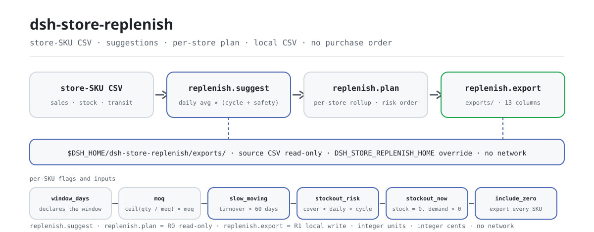

<div align="center">

<picture>
  <source media="(prefers-color-scheme: dark)" srcset="docs/assets/dsh-store-replenish-flow-dark.svg">
  
</picture>

# dsh-store-replenish

**Convierte una tabla CSV de ventas e inventario por tienda-SKU en sugerencias de reposición por SKU, pedidos de reposición por tienda y un CSV de reposición.**

Plugin de cálculo de reposición para DeepSeek Harness: `media diaria × (días de ciclo + días de seguridad) − existencias − en tránsito`, redondeado hacia arriba al MOQ, con marcas de baja rotación y de riesgo de ruptura. Todo local, sin dependencias en tiempo de ejecución, sin red y sin generar pedidos de compra.

[Instalación](#instalación-en-tres-pasos) · [Configuración](#configuración) · [FAQ](#faq) · [简体中文](README.md) · [English](README.en.md) · [Español](README.es.md) · [Português](README.pt.md) · [हिन्दी](README.hi.md)

[](LICENSE)
[](#compatibilidad)
[](https://www.npmjs.com/package/dsh-store-replenish)
[](https://github.com/PerryLink/dsh-store-replenish/actions/workflows/ci.yml)
[](#compatibilidad)

[](https://github.com/PerryLink/dsh-store-replenish/stargazers)
[](https://www.npmjs.com/package/dsh-store-replenish)
[](https://dshfind.com/plugins/PerryLink/dsh-store-replenish?ref=badge)

```sh
dsh plugin --profile <profile> add dsh-store-replenish
```

</div>

<sub>Plugin de la comunidad, sin relación con DeepSeek. Repositorio único: <https://github.com/PerryLink/dsh-store-replenish>. Estado: alpha · solo datos públicos/sintéticos · no GA — sin datos de tienda, de producto ni evidencia de ventas, y sin afirmaciones de producción, compra o finanzas.</sub>

## Qué es

Lee el CSV de ventas e inventario por tienda-SKU que indique el usuario y calcula una cantidad sugerida por tienda-SKU con una sola regla auditable: la media diaria × (días de ciclo + días de seguridad) da el stock objetivo, se restan existencias y tránsito, y el hueco se redondea hacia arriba al MOQ. Agrega el resultado en un pedido por tienda y, cuando hace falta un archivo, lo escribe como CSV local. Los SKU con rotación superior a 60 días se marcan como baja rotación, y los SKU cuya disponibilidad no cubre el siguiente ciclo se marcan como riesgo de ruptura; pero no emite pedidos, no transfiere y no se integra con ERP/POS/WMS. Produce una sugerencia y una tabla revisable, nada más.

- **Encaja:** de decenas a miles de combinaciones tienda-SKU; fijar una regla auditable para media diaria, existencias, tránsito, días de seguridad, días de ciclo y MOQ; recuentos por tienda, unidades totales e importe estimado; decidir el orden de reposición por riesgo de ruptura; una lista de reposición para que la revise el responsable de tienda, el comprador o el almacén.
- **No encaja:** emitir pedidos de compra, traspasos o integración con ERP/POS/WMS; multi-almacén, multimoneda, impuestos o precios con impuesto; promociones, temporadas, vida útil, lotes o caducidad; EOQ, coste de mantenimiento, nivel de servicio u optimización de stock de seguridad (los días de seguridad son una entrada); leer Excel/PDF/imágenes directamente (exporta primero a CSV); tratar la sugerencia como un compromiso de compra.

## Instalación en tres pasos

1. **Instalar** (elige un canal):

   ```sh
   # canal npm (recomendado, versiones publicadas)
   dsh plugin --profile <profile> add dsh-store-replenish
   # canal git (último main; equivale a git+https://github.com/PerryLink/dsh-store-replenish.git)
   dsh plugin --profile <profile> add github:PerryLink/dsh-store-replenish
   # canal tarball: pnpm pack en este repositorio y luego
   dsh plugin --profile <profile> add ./dsh-store-replenish-<version>.tgz
   ```

2. **Configuración mínima**: no hay claves de configuración del plugin — `cordis.patch.yml` solo `insert`a una fila y los valores por defecto funcionan. Lo ajustable son dos variables de entorno y los argumentos de las herramientas (ver «Configuración»).

   ```yaml
   - insert:
       - id: dsh-store-replenish
         name: dsh-store-replenish
   ```

3. **Verificar que está montado**:

   ```sh
   dsh --profile <profile> --dump-config | grep dsh-store-replenish
   node samples/quickstart/run.mjs --check
   ```

   El quickstart ejecuta la muestra sintética incluida (2 tiendas × 8 SKU) por toda la cadena y debe terminar con:

   ```text
   dsh-store-replenish quickstart - synthetic 2 stores x 8 SKUs (not store data)
   30-day window: 16 store-SKU rows, 11 order line(s), 398 unit(s), 4,768.80; 2 stockout risk(s), 1 slow-moving
   golden samples/quickstart/expected/result.json matches
   quickstart ok
   ```

**Desinstalar**: `dsh plugin --profile <profile> remove dsh-store-replenish` (o quita la fila del patch del perfil).

<details>
<summary>Instalar desde el mercado de DSH Desktop</summary>

Todos los plugins de PerryLink están en el mercado integrado de DSH Desktop: **Mercado → Fuentes → Añadir fuente → pegar** `https://perrylink-dsh-catalog.perrylink.workers.dev/catalog-source.json` **→ seleccionar**. La instalación sigue requiriendo la comprobación de identidad npm del mercado y tu confirmación.

</details>

## Capacidades clave

- **Sugerencias por SKU** — `replenish.suggest` lee el CSV tienda-SKU y calcula la cantidad sugerida de cada SKU a partir de la media diaria, los días de ciclo, los días de seguridad, las existencias, el tránsito y el MOQ, devolviendo media diaria, días de cobertura, días de rotación, cantidad objetivo, hueco, importe estimado y tres marcas.
- **Pedidos por tienda** — `replenish.plan` agrega las sugerencias en un pedido por tienda: número de SKU, líneas de pedido, unidades totales, importe estimado, recuentos de riesgo y de baja rotación, ordenado por riesgo de ruptura y conservando el detalle de cada SKU.
- **CSV local revisable** — `replenish.export` escribe el pedido como CSV de 13 columnas fijas en `$DSH_HOME/dsh-store-replenish/exports/` y devuelve ruta, `sha256`, bytes y recuentos de filas; por defecto solo escribe los SKU con cantidad sugerida positiva.
- **Marcas de baja rotación y ruptura** — rotación superior a 60 días activa `slow_moving`; existencias + tránsito que no cubren el siguiente ciclo activa `stockout_risk`; existencias ya en 0 con demanda activa `stockout_now`.
- **Orden determinista** — el orden de tiendas y SKU está fijado por reglas (riesgo → importe → nombre / SKU), así que la misma entrada produce siempre la misma salida y se puede revisar o archivar.
- **Aritmética entera** — las unidades son enteras y el dinero son céntimos enteros; el redondeo al MOQ usa numerador/denominador enteros, de modo que un múltiplo exacto nunca salta de tramo por un error de coma flotante.
- **Solo local** — no hay ninguna llamada `fetch` / HTTP / DNS / WebSocket en el código; los metadatos de demostración de `package.json` declaran `network: false` y `external: []`.

### Superficie de herramientas

Los nombres de las herramientas son API estable (se mantienen en inglés para coincidir con la salida del runtime). Las de solo lectura son **R0**; la de escritura local es **R1**.

| Herramienta | Uso | Riesgo |
|---|---|---|
| `replenish.suggest` | Lee el CSV tienda-SKU y calcula la cantidad sugerida por SKU a partir de media diaria, días de ciclo, días de seguridad, existencias, tránsito y MOQ; marca baja rotación y riesgo de ruptura | R0 solo lectura |
| `replenish.plan` | Agrega un pedido de reposición por tienda (número de SKU, líneas, unidades, importe estimado, recuentos de riesgo), ordenado por riesgo de ruptura | R0 solo lectura |
| `replenish.export` | Escribe el CSV de reposición (tienda/SKU/nombre/existencias/tránsito/media/ciclo/seguridad/sugerido/importe/riesgo/baja rotación/rotación) y devuelve ruta + sha256 | R1 escritura local |

### Entrada

- **Formato**: CSV UTF-8 con fila de cabecera y separador de coma; admite comillas RFC 4180, saltos de línea internos, CRLF y BOM UTF-8.
- **Cabecera**: `store,sku,name,sales_qty,stock_qty,in_transit,safety_days,cycle_days,moq,unit_price_cents`. También se aceptan alias de cabecera en chino; `name` es opcional y cae al SKU; las columnas extra se ignoran.

```text
store,sku,name,sales_qty,stock_qty,in_transit,safety_days,cycle_days,moq,unit_price_cents
门店,SKU,品名,销量,当前库存,在途,安全天数,补货周期天数,起订量,单价分
```

- **Ventana de ventas**: `sales_qty` es la demanda acumulada **dentro de la ventana declarada**, en la misma unidad que las existencias. La ventana es el argumento `window_days` de la herramienta, por defecto 30.
- **Números**: ventas, existencias, tránsito, días de seguridad, días de ciclo, MOQ y precio unitario son enteros no negativos; el MOQ es al menos 1; los días de seguridad y de ciclo se limitan a 3650; el precio es **céntimos** enteros. Valores negativos, fraccionarios, vacíos o fuera de rango son `E_REPL_QTY`.
- **Tienda-SKU**: un par `(tienda, SKU)` puede aparecer una vez por archivo; distintas tiendas pueden vender el mismo SKU.
- **Tamaño y origen**: hasta 20 MB por archivo — más allá, divide por tienda o categoría. El origen es el CSV local que indique el usuario; es de solo lectura y nunca se modifica.

### Salida

- **`replenish.suggest`**: `{ window_days, source_sha256, totals, items }`. Cada SKU lleva media diaria, días de cobertura, días de rotación, cantidad objetivo, hueco bruto, cantidad sugerida, importe estimado y las marcas `slow_moving`, `stockout_risk` y `stockout_now`. Los elementos se ordenan de forma determinista por tienda, riesgo, cantidad y SKU.
- **`replenish.plan`**: `{ window_days, source_sha256, totals, stores }`. Por tienda: `sku_count`, `order_lines`, `total_units`, `estimated_value_cents`, recuentos de riesgo y de baja rotación, y `risk_level` (high/medium/low). Las tiendas se ordenan por riesgo de ruptura y conservan el detalle de cada SKU.
- **`replenish.export`**: escribe el pedido de reposición como CSV en `$DSH_HOME/dsh-store-replenish/exports/` con una cabecera fija de 13 columnas, y devuelve ruta, `sha256`, bytes y recuentos de filas. Por defecto solo escribe los SKU con cantidad sugerida positiva; `include_zero=true` añade el resto para revisión.

```text
门店,SKU,品名,当前库存,在途,日均销量,补货周期天数,安全天数,建议补货量,预估金额,缺货风险,滞销,周转天数
```

### Reglas

1. Media diaria = `sales_qty / window_days`; `window_days` es 30 por defecto y acepta 1–3650. Declara qué significa la columna de ventas; la herramienta no consulta historial.
2. Stock objetivo = `media diaria × (cycle_days + safety_days)`.
3. Hueco = `objetivo − existencias − en tránsito`; el tránsito cuenta como stock disponible.
4. Cantidad sugerida = 0 si el hueco es ≤ 0; en caso contrario `ceil(hueco / moq) × moq`. El redondeo al MOQ usa aritmética entera, así que un múltiplo exacto nunca salta de tramo por la coma flotante.
5. Días de rotación = `existencias / media diaria`; existencias > 0 con rotación > 60 días es baja rotación. Sin ventas pero con existencias da `turnover_days: null` (infinito) y la marca de baja rotación; sin ventas y sin existencias no se marca.
6. Riesgo de ruptura = `existencias + en tránsito < media diaria × cycle_days`, es decir, la disponibilidad no cubre un ciclo completo. `stockout_now=true` significa además existencias 0 con demanda positiva.
7. Orden de tiendas: recuento de `stockout_now` desc → recuento de riesgo desc → importe desc → nombre asc. El riesgo pesa más que el importe, así que una tienda más pequeña puede quedar primero.
8. Orden dentro de la tienda: `stockout_now` → riesgo de ruptura → requiere reposición → baja rotación → otros; dentro del tramo, cantidad desc y luego SKU asc.
9. Importe estimado = `cantidad sugerida × precio en céntimos`; la API devuelve céntimos enteros y el CSV muestra dos decimales.
10. `replenish.export` solo escribe cantidades sugeridas positivas; si no hay ninguna fila así, lanza `E_REPL_EMPTY`. Con `include_zero=true` se escriben todos los SKU, mientras que `order_lines` sigue contando solo las filas positivas.

### Ejemplos

Pega esta línea (es el `dsh.demo.prompt` incluido en `package.json`):

```text
用这份 2 门店 × 8 SKU 的销售库存表，按 30 天窗口算补货建议，汇总成门店补货单并导出补货 CSV。
```

O reproduce la muestra incluida y compárala con el archivo de referencia (una ejecución real — la captura viene de este comando):

```sh
node samples/quickstart/run.mjs --check
```


La muestra son 16 filas sintéticas (2 tiendas × 8 SKU). Contiene un SKU de baja rotación (Chengdu, gel hidroalcohólico 500 ml, rotación 100 días) y dos SKU con riesgo de ruptura (Shanghai, galletas de soda 400 g y leche fresca 950 ml). También cubre un múltiplo exacto de MOQ (12 → 12), un no múltiplo (70 → 72), un hueco exactamente cero (Shanghai, pienso seco para gatos) y un SKU sin ventas (Chengdu, gel hidroalcohólico). El archivo de referencia `samples/quickstart/expected/result.json` es la salida real de `node samples/quickstart/run.mjs --json`, no está escrito a mano; la captura es la salida real de `--check` y los hashes del comando y de la salida están en `screenshots.json`.

*Observed from `src/plugin/tools.ts:159-168` (la línea de render de `replenish.suggest`) y `docs/assets/quickstart.log`*

## Datos medidos

La suite de aceptación pública/sintética se reproduce con `node scripts/gate.mjs` (`scripts/lint.mjs` + `scripts/acceptance.mjs` + cada fila de `ACCEPTANCE.csv` con `pass=true`); el detalle está en `ACCEPTANCE.csv`. Registro actual:

- **Pruebas**: `node --test test/*.test.mjs` → 121 pasan, 0 fallan (15 archivos de prueba).
- **Puertas**: `node scripts/lint.mjs` → 9 archivos fuente / 15 archivos de prueba / 121 pruebas / 16 entradas publicadas; `node scripts/gate.mjs` → `gate ok: 16 acceptance rows`.
- **Referencia**: `node samples/quickstart/run.mjs --check` → `golden samples/quickstart/expected/result.json matches`.
- **Forma de la muestra**: con la ventana de 30 días, 16 filas tienda-SKU → 11 líneas de pedido, 398 unidades, 4.768,80 estimados; Shanghai 6 líneas / 282 unidades / 2 riesgos de ruptura (medium), Chengdu 5 líneas / 116 unidades / 0 riesgos (low).

Las 16 filas de `ACCEPTANCE.csv`, citadas literalmente (el archivo completo lleva además `script` y `evidence_sha256`):

```csv
req_id,metric,threshold,actual,pass,source,counted
AC-R01,suggest totals,rows=16 stores=2 unique_skus=8 order_lines=11 units=398 value=476880 risk=2 slow=1,rows=16 stores=2 unique_skus=8 order_lines=11 units=398 value=476880 risk=2 slow=1,true,public/synthetic,false
AC-R02,MOQ rounding,苏打=72 牛奶=60 乌龙=30 坚果=12,苏打=72 牛奶=60 乌龙=30 坚果=12,true,public/synthetic,false
AC-R03,stockout and slow flags,risk=上海静安店/SKU-DA-001|上海静安店/SKU-SN-001 slow=成都高新店/SKU-HH-002 now=0,risk=上海静安店/SKU-DA-001|上海静安店/SKU-SN-001 slow=成都高新店/SKU-HH-002 now=0,true,public/synthetic,false
AC-R04,store aggregation,上海=8/6/282/290820/2/medium 成都=8/5/116/186060/0/low,上海=8/6/282/290820/2/medium 成都=8/5/116/186060/0/low,true,public/synthetic,false
AC-R05,store risk order,order=上海静安店/成都高新店,order=上海静安店/成都高新店,true,public/synthetic,false
AC-R06,plan equals suggest totals,totals=same source=same,totals=same source=same,true,public/synthetic,false
AC-R07,replenishment CSV,rows=11 lines=12 stores=2 units=398 value=476880 header=ok hash=ok,rows=11 lines=12 stores=2 units=398 value=476880 header=ok hash=ok,true,public/synthetic,false
AC-R08,include zero,rows=16 slow=1,rows=16 slow=1,true,public/synthetic,false
AC-R09,15-day window,order_lines=14 units=1774 risk=13,order_lines=14 units=1774 risk=13,true,public/synthetic,false
AC-R10,bad quantity,E_REPL_QTY,E_REPL_QTY,true,public/synthetic,false
AC-R11,missing column,E_REPL_CSV_ROW,E_REPL_CSV_ROW,true,public/synthetic,false
AC-R12,empty table,E_REPL_EMPTY,E_REPL_EMPTY,true,public/synthetic,false
AC-R13,export path safety,E_REPL_PATH_INVALID,E_REPL_PATH_INVALID,true,public/synthetic,false
AC-R14,no order to export,E_REPL_EMPTY then rows=1,E_REPL_EMPTY then rows=1,true,public/synthetic,false
AC-R15,first CSV row,上海静安店|SKU-SN-001|苏打饼干 400g|20|10|10.00|7|3|72|928.80|是|否|2.0,上海静安店|SKU-SN-001|苏打饼干 400g|20|10|10.00|7|3|72|928.80|是|否|2.0,true,public/synthetic,false
PS1-QS01,quickstart golden,1/1,1,true,synthetic/quickstart,true
```

Todas las filas excepto `PS1-QS01` (reproducción local de la muestra incluida, `counted=true`) son comprobaciones sobre fixtures públicos/sintéticos (`counted=false`); ninguna es una ejecución de tienda y no hay salidas inventadas. El entorno y los hashes están en [`EVIDENCE.md`](EVIDENCE.md).

## Configuración

Este plugin no tiene claves de configuración de Schemastery: `cordis.patch.yml` solo `insert`a una fila (`id: dsh-store-replenish`) y los valores por defecto funcionan. Lo ajustable son dos variables de entorno y cuatro argumentos de herramienta.

| Variable | Valor por defecto | Significado |
|---|---|---|
| `DSH_HOME` | el cwd del proceso host | Base de la raíz de escritura local; las exportaciones van a `<DSH_HOME>/dsh-store-replenish/exports/`, o `cwd/dsh-store-replenish/exports/` si no está definida |
| `DSH_STORE_REPLENISH_HOME` | sin definir | Sustituye directamente la raíz de escritura local (para pruebas); `exports/` cuelga de ella sin el segmento `dsh-store-replenish` |

Argumentos de herramienta más usados:

| Argumento | Valor por defecto | Aplica a | Significado |
|---|---|---|---|
| `path` | obligatorio | las tres herramientas | Ruta del CSV tienda-SKU que indica el usuario; solo lectura, nunca se reescribe |
| `window_days` | `30` | las tres herramientas | Cuántos días de demanda acumulada cubre `sales_qty`, 1–3650; fuera de rango es `E_REPL_QTY` |
| `filename` | `replenish-<window_days>d.csv` | `replenish.export` | Nombre del archivo de exportación; debe coincidir con `^[A-Za-z0-9._-]{1,120}$` y resolverse dentro de `exports/` |
| `include_zero` | `false` | `replenish.export` | `true` escribe también los SKU con sugerencia cero, para que se vea por qué no se pidió nada |

<details>
<summary>Códigos de error y solución de problemas</summary>

| Código | Cuándo | Siguiente acción |
|---|---|---|
| `E_REPL_QTY` | Ventas/existencias/tránsito/días de seguridad/días de ciclo/MOQ/precio negativo, fraccionario, vacío o fuera de rango; MOQ 0; `window_days` fuera de 1–3650 | Usa enteros no negativos, MOQ ≥ 1, ventana 1–3650 |
| `E_REPL_CSV_ROW` | Número de columnas incorrecto, cabecera ausente o duplicada, tienda/SKU vacío, par tienda-SKU duplicado, archivo > 20 MB | Corrige esa fila; `(tienda, SKU)` debe ser único |
| `E_REPL_EMPTY` | CSV vacío o solo con cabecera; exportación sin ninguna cantidad sugerida positiva | Comprueba que hay filas; pasa `include_zero=true` para ver todos los SKU |
| `E_REPL_PATH_INVALID` | Entrada ausente, directorio, ilegible; nombre de exportación inseguro; fallo de escritura | Pasa un CSV existente; exporta solo con `[A-Za-z0-9._-]` |

Formato del mensaje: una frase llana, el código y una acción siguiente:

```text
<one sentence>（E_REPL_XXX）｜下一步：<one action>｜细节：<optional>
```

Diagnóstico por síntoma / causa / acción en [`TROUBLESHOOTING.md`](TROUBLESHOOTING.md).

</details>

## FAQ

<details>
<summary>¿Por qué la sugerencia difiere de mi cálculo manual en una caja?</summary>

Porque redondea hacia arriba al MOQ. Un hueco de 70 con MOQ 24 se convierte en `ceil(70/24)=3`, es decir 72 en lugar de 70. Revisa `raw_qty` y `moq`; `suggested_qty` siempre es múltiplo del MOQ.

</details>

<details>
<summary>¿Se excluyen los SKU de baja rotación de la reposición?</summary>

No. La fórmula manda: un hueco positivo sigue generando sugerencia, con `slow_moving=true` como aviso. En la práctica conviene revisar por qué el stock está parado; este paquete lo marca y no pone la sugerencia a cero ni decide una retirada.

</details>

<details>
<summary>¿`window_days` recupera automáticamente los últimos N días?</summary>

No. Declara cuántos días cubre la columna `sales_qty`. Pasar 15 significa leer la misma columna como demanda de 15 días, así que la media diaria sube. La herramienta nunca lee historial ni llama a ningún sistema externo.

</details>

<details>
<summary>¿El tránsito cuenta como existencias o como rotación?</summary>

El tránsito cuenta como stock disponible (reduce el hueco y afecta al riesgo de ruptura), pero **no** forma parte de la rotación, que solo usa existencias actuales.

</details>

<details>
<summary>¿Cuál es la diferencia entre `stockout_risk` y `stockout_now`?</summary>

`stockout_now` significa que las existencias ya son 0 con demanda positiva. `stockout_risk` significa que existencias + tránsito no llegan hasta la próxima reposición (`< media diaria × cycle_days`). Con mucho tránsito puedes tener `stockout_now=true` y `stockout_risk=false`.

</details>

<details>
<summary>¿Modifica o sube mi archivo?</summary>

No. Lee el CSV indicado, escribe solo en `$DSH_HOME/dsh-store-replenish/exports/` y nunca usa red, modelos ni subidas. El CSV de origen no se modifica.

</details>

<details>
<summary>¿Puede leer Excel o conectarse a un sistema de compras?</summary>

No. Solo CSV; no emite pedidos de compra, no llama a ERP/POS/WMS y no envía mensajes. Entrega el CSV exportado a tu proceso actual y revísalo.

</details>

## Límites de seguridad

- **Sin red y sin modelos.** El código no contiene llamadas `fetch` / HTTP / DNS / WebSocket; los metadatos de demostración de `package.json` declaran `network: false` y `external: []`. Entrada y salida se quedan en local.
- **El archivo de origen es de solo lectura.** Solo se lee el CSV indicado, nunca se reescribe; las escrituras van únicamente al CSV de reposición bajo `<DSH_HOME>/dsh-store-replenish/exports/`.
- **Ruta de exportación acotada.** El nombre debe coincidir con `^[A-Za-z0-9._-]{1,120}$` y la ruta resuelta debe quedar bajo el `realpath` de `exports/`; traversal, redirección por symlink y rutas absolutas son `E_REPL_PATH_INVALID`.
- **Entrada acotada.** Como máximo 20 MB por archivo; un archivo vacío es `E_REPL_EMPTY`; un directorio o una ruta ilegible es `E_REPL_PATH_INVALID`; columnas, cabecera o par tienda-SKU duplicado son `E_REPL_CSV_ROW`.
- **Aritmética entera.** Unidades y dinero son enteros (dinero en céntimos) y el redondeo al MOQ usa numerador/denominador enteros, para que un múltiplo exacto no salte de tramo por coma flotante.
- **Falla en voz alta, sin superficie oculta.** Los cuatro códigos se reducen a una frase llana y una acción siguiente; nada degrada en silencio y no hay salidas inventadas. No registra comandos, slots de cliente, rutas `webServer` ni claves de servicio: el host solo inyecta `tools`.

## Permisos y datos

- **Lee**: el CSV de ventas e inventario por tienda-SKU que indica el usuario (muestra: `samples/quickstart/input/store-replenish.csv`); nada más.
- **Escribe**: solo `$DSH_HOME/dsh-store-replenish/exports/` (CSV de reposición); el CSV de origen no se modifica.
- **Red**: no.
- **Sistemas externos**: ninguno.
- **Niveles de riesgo**: `replenish.suggest` y `replenish.plan` son **R0** (solo lectura); `replenish.export` es **R1** (escritura local bajo `exports/`). `DSH_STORE_REPLENISH_HOME` permite cambiar la raíz de escritura local en pruebas; el valor por defecto es exactamente `$DSH_HOME/dsh-store-replenish`.
- **Frontera de datos**: solo muestras públicas/sintéticas; sin datos de tienda, de producto ni evidencia de ventas.

## Limitaciones conocidas

- **No emite pedidos ni traspasos:** solo sugerencias y un CSV local; sin compras, integración ERP/POS/WMS ni mensajería.
- **Un solo almacén y una sola moneda:** la entrada no tiene columnas de almacén, moneda ni impuestos; divide archivos o convierte en el sistema de origen.
- **Los días de seguridad son una entrada:** sin previsión de demanda, estacionalidad, promociones, nivel de servicio ni optimización EOQ.
- **Sin vida útil ni lotes:** no modela caducidad, lotes, números de serie, FIFO ni mermas.
- **La ventana se declara:** `sales_qty` cubre `window_days` días; la herramienta no busca historial.
- **La rotación es una marca:** la baja rotación usa solo el umbral de 60 días; retirar, liquidar o devolver es decisión tuya.
- **Solo CSV:** no lee Excel/PDF/imágenes ni hace OCR.
- **Sin limpieza de inyección de fórmulas:** el CSV exportado solo aplica comillas RFC 4180 y no elimina prefijos de fórmula de Excel; no abras CSV de origen desconocido directamente en Excel.
- **Medidas enteras:** solo unidades enteras y céntimos enteros; sin cajas partidas, productos a peso ni medidas decimales.
- **Solo público/sintético:** alpha/partial, not counted, sin afirmaciones de GA ni de producción; solo `PS1-QS01` es `counted=true` en `ACCEPTANCE.csv`.

## Interoperabilidad con otros plugins DSH

Este plugin **no interfiere** con otros plugins:

- **Nombres de herramienta con espacio de nombres.** Las tres viven bajo `replenish.*`; no registra ningún nombre desnudo de una herramienta integrada ni de otro plugin.
- **No ocupa superficie del host.** No registra comandos, slots de cliente, rutas `webServer` ni claves de servicio; `inject` es solo `tools` y la presencia de herramientas se decide por el contrato del host.
- **La capa de patch solo `insert`a.** `cordis.patch.yml` inserta su propia fila y nunca sobrescribe el `config` de una fila integrada.
- **Sin mutación global.** No parchea prototipos ni sustituye el dispatcher global de fetch; solo lee las variables `DSH_HOME` y `DSH_STORE_REPLENISH_HOME`.
- **Papeles complementarios.** La validación de datos maestros de producto corresponde a [`dsh-pim-lint`](https://github.com/PerryLink/dsh-pim-lint) y la comprobación de listados a [`dsh-pim-listing`](https://github.com/PerryLink/dsh-pim-listing); cada uno es un paquete independiente que se instala si hace falta.

## Compatibilidad

| Superficie | Estado |
|---|---|
| Harness | DeepSeek Harness `>=0.2.1-rc.3 <0.4.0` (`engines.dsh` de `package.json`) |
| Node | `>=24.9.0 <25` (`.nvmrc`: 24) |
| Plataformas | Donde corra DSH; solo archivos locales |
| Datos | Sin red, sin llamadas a modelos, sin subidas |

## Ecosistema y calidad

- [Página del plugin en dshfind](https://dshfind.com/plugins/PerryLink/dsh-store-replenish) (instalaciones y ranking)
- Documentación: [`TROUBLESHOOTING.md`](TROUBLESHOOTING.md) (síntoma / causa / acción) · [`EVIDENCE.md`](EVIDENCE.md) (entorno, resultados de comandos y hashes)
- Índices: [Índice de dominio](https://perrylink.github.io/dsh-plugins/) · [Base de conocimiento del ecosistema](https://perrylink.github.io/dsh-plugin-guide/) (guía de desarrollo · datos de selección · criterios de mantenimiento)

### Trabajo relacionado

- [dsh-pim-lint](https://github.com/PerryLink/dsh-pim-lint) (validación de datos maestros de producto) · [dsh-pim-listing](https://github.com/PerryLink/dsh-pim-listing) (comprobación de listados de producto)

## Desarrollo

```sh
pnpm install --frozen-lockfile
pnpm build && pnpm lint && pnpm typecheck
node --test test/*.test.mjs
node scripts/gate.mjs                    # lint + aceptación + cada fila de ACCEPTANCE.csv en pass
node samples/quickstart/run.mjs --check  # muestra sintética, debe imprimir quickstart ok
```

El código TypeScript está en `src/` (`src/core/` contiene el análisis de CSV, el cálculo de reposición, el redondeo al MOQ, el dinero en céntimos enteros, la exportación y la seguridad de rutas; `src/plugin/` contiene la cara del host y el registro de herramientas); la compilación sale a `lib/`; la muestra incluida está en `samples/quickstart/`. Versión actual `0.1.0` (coincide con `package.json`). Las pruebas se ejecutan con `node --test test/*.test.mjs`; los skip por falta de una muestra pública son normales, no fallos.

El diagrama de cabecera lo genera [`scripts/gen-readme-assets.py`](scripts/gen-readme-assets.py) (Python + Pillow; aborta con un error claro si no encuentra una fuente CJK): `python scripts/gen-readme-assets.py` se puede repetir y escribe `docs/assets/dsh-store-replenish-flow-{light,dark}.svg`. Este repositorio no incluye un conjunto de benchmark, así que no hay gráfico de evidencia.

Topics: `deepseek-harness`, `dsh`, `dsh-plugin`, `retail`, `replenishment`, `inventory`, `stockout`, `store-ops`, `csv`, `perrylink`

## Familia y agradecimientos

Este proyecto forma parte de la familia de plugins de DeepSeek Harness de [PerryLink](https://github.com/PerryLink) (todos Apache-2.0). Si te resulta útil, **una estrella ayuda a que la siguiente persona lo encuentre** — no desbloquea ninguna función.

- [@PerryLink](https://github.com/PerryLink) — creador y mantenedor: la fórmula de reposición y el redondeo entero al MOQ, el orden de tiendas y las marcas de riesgo, el CSV de reposición de 13 columnas, el quickstart y la suite de aceptación, y la documentación en cinco idiomas.

## Licencia

[LICENSE](LICENSE) (Apache License 2.0) © 2026 dsh-store-replenish contributors; véanse también `NOTICE` y `THIRD-PARTY-NOTICES`.

<p align="center"><sub>Apache-2.0 · Plugin de la comunidad, sin relación con DeepSeek.</sub></p>
