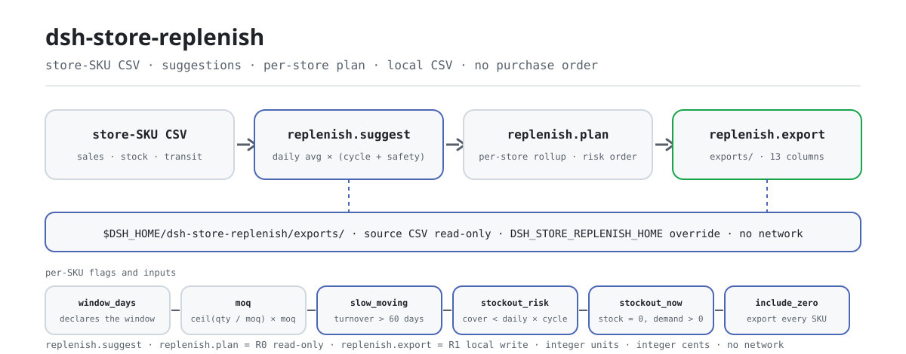

<div align="center">

<picture>
  <source media="(prefers-color-scheme: dark)" srcset="docs/assets/dsh-store-replenish-flow-dark.svg">
  
</picture>

# dsh-store-replenish

**स्टोर-SKU बिक्री और इन्वेंटरी CSV को प्रति-SKU पुनःपूर्ति सुझावों, प्रति-स्टोर पुनःपूर्ति ऑर्डर और पुनःपूर्ति CSV में बदलता है।**

DeepSeek Harness के लिए पुनःपूर्ति गणना प्लगइन: `दैनिक औसत × (साइकल दिन + सेफ्टी दिन) − स्टॉक − ट्रांज़िट में`, जिसे MOQ तक ऊपर की ओर पूर्णांकित किया जाता है, साथ में धीमी गति और स्टॉकआउट जोखिम के चिह्न। पूरी तरह लोकल, कोई रनटाइम निर्भरता नहीं, कोई नेटवर्क नहीं और कोई खरीद ऑर्डर नहीं।

[इंस्टॉल](#तीन-चरणों-में-शुरुआत) · [कॉन्फ़िगरेशन](#कॉन्फ़िगरेशन) · [FAQ](#faq) · [简体中文](README.md) · [English](README.en.md) · [Español](README.es.md) · [Português](README.pt.md) · [हिन्दी](README.hi.md)

[](LICENSE)
[](#संगतता)
[](https://www.npmjs.com/package/dsh-store-replenish)
[](https://github.com/PerryLink/dsh-store-replenish/actions/workflows/ci.yml)
[](#संगतता)

[](https://github.com/PerryLink/dsh-store-replenish/stargazers)
[](https://www.npmjs.com/package/dsh-store-replenish)
[](https://dshfind.com/plugins/PerryLink/dsh-store-replenish?ref=badge)

```sh
dsh plugin --profile <profile> add dsh-store-replenish
```

</div>

<sub>समुदाय प्लगइन, DeepSeek से संबद्ध नहीं। एकमात्र रेपो: <https://github.com/PerryLink/dsh-store-replenish>। स्थिति: alpha · केवल सार्वजनिक/कृत्रिम डेटा · GA नहीं — कोई स्टोर डेटा, उत्पाद डेटा या बिक्री साक्ष्य नहीं, और उत्पादन-उपयोग, खरीद या वित्तीय दावा नहीं।</sub>

## यह क्या है

उपयोगकर्ता द्वारा बताई गई स्टोर-SKU बिक्री/इन्वेंटरी CSV पढ़ता है और एक ही ऑडिट-योग्य नियम से प्रत्येक स्टोर-SKU के लिए सुझाई गई मात्रा निकालता है: दैनिक औसत × (साइकल दिन + सेफ्टी दिन) से लक्ष्य स्टॉक बनता है, उसमें से स्टॉक और ट्रांज़िट घटाया जाता है, और बची खाई को MOQ तक ऊपर की ओर पूर्णांकित किया जाता है। फिर परिणाम को प्रति-स्टोर ऑर्डर में समेटता है और ज़रूरत पड़ने पर लोकल पुनःपूर्ति CSV लिखता है। 60 दिन से अधिक टर्नओवर वाले SKU धीमी गति के रूप में चिह्नित होते हैं, और जिन SKU का उपलब्ध स्टॉक अगला साइकल नहीं काट पाता वे स्टॉकआउट जोखिम के रूप में; लेकिन ऑर्डर देना, ट्रांसफ़र करना और ERP/POS/WMS से जुड़ना इसके दायरे से बाहर है। यह केवल सुझाव और समीक्षा-योग्य तालिका देता है।

- **उपयुक्त:** दसियों से हज़ारों स्टोर-SKU संयोजन; दैनिक औसत, स्टॉक, ट्रांज़िट, सेफ्टी दिन, साइकल दिन और MOQ को एक ऑडिट-योग्य नियम में बाँधना; प्रति-स्टोर SKU संख्या, कुल इकाई और अनुमानित राशि; स्टॉकआउट जोखिम के आधार पर पुनःपूर्ति क्रम तय करना; स्टोर प्रबंधक, खरीदार या वेयरहाउस के समीक्षा हेतु सूची।
- **उपयुक्त नहीं:** खरीद ऑर्डर जारी करना, ट्रांसफ़र या ERP/POS/WMS एकीकरण; मल्टी-वेयरहाउस, मल्टी-करेंसी, कर या कर-सहित मूल्य; प्रमोशन, मौसम, शेल्फ लाइफ़, बैच या एक्सपायरी; EOQ, कैरिंग कॉस्ट, सर्विस लेवल या सेफ्टी-स्टॉक ऑप्टिमाइज़ेशन (सेफ्टी दिन इनपुट हैं); सीधे Excel/PDF/इमेज पढ़ना (पहले CSV निर्यात करें); सुझाव को खरीद प्रतिबद्धता मानना।

## तीन चरणों में शुरुआत

1. **इंस्टॉल** (कोई एक चैनल चुनें):

   ```sh
   # npm चैनल (अनुशंसित, प्रकाशित संस्करण)
   dsh plugin --profile <profile> add dsh-store-replenish
   # git चैनल (नवीनतम main; git+https://github.com/PerryLink/dsh-store-replenish.git के बराबर)
   dsh plugin --profile <profile> add github:PerryLink/dsh-store-replenish
   # tarball चैनल: इस रेपो में pnpm pack के बाद
   dsh plugin --profile <profile> add ./dsh-store-replenish-<version>.tgz
   ```

2. **न्यूनतम कॉन्फ़िगरेशन**: प्लगइन-स्तरीय कोई कॉन्फ़िग कुंजी नहीं है — `cordis.patch.yml` केवल एक पंक्ति `insert` करता है और डिफ़ॉल्ट चल जाते हैं। बदलने योग्य दो एनवायरनमेंट वेरिएबल और टूल आर्ग्युमेंट हैं (देखें «कॉन्फ़िगरेशन»)।

   ```yaml
   - insert:
       - id: dsh-store-replenish
         name: dsh-store-replenish
   ```

3. **जाँचें कि माउंट हुआ**:

   ```sh
   dsh --profile <profile> --dump-config | grep dsh-store-replenish
   node samples/quickstart/run.mjs --check
   ```

   quickstart साथ आए कृत्रिम नमूने (2 स्टोर × 8 SKU) को पूरी श्रृंखला से चलाता है और अंत में यह छापना चाहिए:

   ```text
   dsh-store-replenish quickstart - synthetic 2 stores x 8 SKUs (not store data)
   30-day window: 16 store-SKU rows, 11 order line(s), 398 unit(s), 4,768.80; 2 stockout risk(s), 1 slow-moving
   golden samples/quickstart/expected/result.json matches
   quickstart ok
   ```

**अनइंस्टॉल**: `dsh plugin --profile <profile> remove dsh-store-replenish` (या प्रोफ़ाइल पैच से वह पंक्ति हटा दें)।

<details>
<summary>DSH Desktop मार्केट से इंस्टॉल करें</summary>

सभी PerryLink प्लगइन DSH Desktop के अंतर्निहित मार्केट में उपलब्ध हैं: **मार्केट → स्रोत → स्रोत जोड़ें → पेस्ट करें** `https://perrylink-dsh-catalog.perrylink.workers.dev/catalog-source.json` **→ चुनें**। इंस्टॉल के लिए मार्केट की npm पहचान जाँच और आपकी पुष्टि अब भी ज़रूरी है।

</details>

## मुख्य क्षमताएँ

- **प्रति-SKU सुझाव** — `replenish.suggest` स्टोर-SKU CSV पढ़कर दैनिक औसत, साइकल दिन, सेफ्टी दिन, स्टॉक, ट्रांज़िट और MOQ से प्रत्येक SKU की सुझाई गई मात्रा निकालता है, और दैनिक औसत, कवर दिन, टर्नओवर दिन, लक्ष्य मात्रा, खाई, अनुमानित राशि तथा तीन चिह्न लौटाता है।
- **प्रति-स्टोर ऑर्डर** — `replenish.plan` सुझावों को प्रति-स्टोर एक ऑर्डर में समेटता है: SKU संख्या, ऑर्डर पंक्तियाँ, कुल इकाई, अनुमानित राशि, स्टॉकआउट जोखिम और धीमी गति की संख्या, स्टॉकआउट जोखिम के क्रम में, हर SKU का विवरण बनाए रखते हुए।
- **समीक्षा-योग्य लोकल CSV** — `replenish.export` ऑर्डर को 13 निश्चित स्तंभों वाली CSV के रूप में `$DSH_HOME/dsh-store-replenish/exports/` में लिखता है और पथ, `sha256`, बाइट तथा पंक्ति संख्या लौटाता है; डिफ़ॉल्ट में केवल धनात्मक सुझाव वाले SKU लिखे जाते हैं।
- **धीमी गति और स्टॉकआउट चिह्न** — 60 दिन से अधिक टर्नओवर `slow_moving` सेट करता है; स्टॉक + ट्रांज़िट जो अगला साइकल न काटे `stockout_risk` सेट करता है; स्टॉक पहले से 0 और माँग धनात्मक हो तो `stockout_now`।
- **नियतात्मक क्रम** — स्टोर और SKU का क्रम पूरी तरह नियमों से तय है (जोखिम → राशि → नाम / SKU), इसलिए एक ही इनपुट हमेशा एक ही आउटपुट देता है और समीक्षा या संग्रह संभव है।
- **पूर्णांक गणना** — इकाइयाँ पूर्णांक हैं और धन पूर्णांक पैसे में; MOQ पूर्णांकन पूर्णांक अंश/हर से होता है, ताकि फ़्लोटिंग-पॉइंट त्रुटि से सटीक गुणक अगली श्रेणी में न चला जाए।
- **केवल लोकल** — सोर्स में कोई `fetch` / HTTP / DNS / WebSocket कॉल नहीं; `package.json` का डेमो मेटाडेटा `network: false` और `external: []` घोषित करता है।

### टूल सतह

टूल नाम स्थिर API हैं (रनटाइम आउटपुट से मेल के लिए अंग्रेज़ी में रखे गए हैं)। केवल-पढ़ने वाले **R0** हैं; लोकल-लेखन वाला **R1** है।

| टूल | उपयोग | जोखिम |
|---|---|---|
| `replenish.suggest` | स्टोर-SKU CSV पढ़कर दैनिक औसत, साइकल दिन, सेफ्टी दिन, स्टॉक, ट्रांज़िट और MOQ से प्रति SKU सुझाई गई मात्रा निकालता है; धीमी गति और स्टॉकआउट जोखिम चिह्नित करता है | R0 केवल पढ़ना |
| `replenish.plan` | प्रति-स्टोर पुनःपूर्ति ऑर्डर (SKU संख्या, पंक्तियाँ, इकाइयाँ, अनुमानित राशि, जोखिम संख्या) स्टॉकआउट जोखिम के क्रम में समेटता है | R0 केवल पढ़ना |
| `replenish.export` | पुनःपूर्ति CSV (स्टोर/SKU/नाम/स्टॉक/ट्रांज़िट/दैनिक/साइकल/सेफ्टी/सुझाव/राशि/जोखिम/धीमी गति/टर्नओवर) लिखकर पथ + sha256 लौटाता है | R1 लोकल लेखन |

### इनपुट

- **प्रारूप**: UTF-8 CSV, हेडर पंक्ति और कॉमा विभाजक; RFC 4180 कोट्स, अंदरूनी नई पंक्तियाँ, CRLF और UTF-8 BOM समर्थित हैं।
- **हेडर**: `store,sku,name,sales_qty,stock_qty,in_transit,safety_days,cycle_days,moq,unit_price_cents`। चीनी हेडर उपनाम भी स्वीकार हैं; `name` वैकल्पिक है और छूटने पर SKU से भर जाता है; अतिरिक्त स्तंभ अनदेखे रहते हैं।

```text
store,sku,name,sales_qty,stock_qty,in_transit,safety_days,cycle_days,moq,unit_price_cents
门店,SKU,品名,销量,当前库存,在途,安全天数,补货周期天数,起订量,单价分
```

- **बिक्री विंडो**: `sales_qty` **घोषित विंडो के भीतर** की संचयी माँग है, उसी इकाई में जिसमें स्टॉक है। विंडो टूल का `window_days` आर्ग्युमेंट है, डिफ़ॉल्ट 30।
- **संख्याएँ**: बिक्री, स्टॉक, ट्रांज़िट, सेफ्टी दिन, साइकल दिन, MOQ और इकाई मूल्य गैर-ऋणात्मक पूर्णांक हैं; MOQ कम से कम 1; सेफ्टी और साइकल दिन 3650 तक सीमित; मूल्य पूर्णांक **पैसे** में। ऋणात्मक, भिन्नात्मक, खाली या सीमा-बाहर मान `E_REPL_QTY` हैं।
- **स्टोर-SKU**: एक `(स्टोर, SKU)` जोड़ी प्रति फ़ाइल एक बार आ सकती है; अलग स्टोर एक ही SKU बेच सकते हैं।
- **आकार और स्रोत**: प्रति फ़ाइल अधिकतम 20 MB — इससे बड़ा हो तो स्टोर या श्रेणी से बाँटें। स्रोत उपयोगकर्ता द्वारा बताई गई लोकल CSV है; वह केवल-पढ़ने योग्य है और कभी बदली नहीं जाती।

### आउटपुट

- **`replenish.suggest`**: `{ window_days, source_sha256, totals, items }`। प्रत्येक SKU में दैनिक औसत, कवर दिन, टर्नओवर दिन, लक्ष्य मात्रा, कच्ची खाई, सुझाई गई मात्रा, अनुमानित राशि और `slow_moving`, `stockout_risk`, `stockout_now` चिह्न होते हैं। आइटम स्टोर, जोखिम, मात्रा और SKU से नियतात्मक रूप से क्रमबद्ध होते हैं।
- **`replenish.plan`**: `{ window_days, source_sha256, totals, stores }`। प्रति स्टोर: `sku_count`, `order_lines`, `total_units`, `estimated_value_cents`, जोखिम और धीमी गति की संख्या, तथा `risk_level` (high/medium/low)। स्टोर स्टॉकआउट जोखिम के क्रम में रहते हैं और हर SKU का विवरण बनाए रखते हैं।
- **`replenish.export`**: पुनःपूर्ति ऑर्डर को 13 स्तंभों वाली निश्चित हेडर के साथ `$DSH_HOME/dsh-store-replenish/exports/` में CSV के रूप में लिखता है, और पथ, `sha256`, बाइट तथा पंक्ति संख्या लौटाता है। डिफ़ॉल्ट में केवल धनात्मक सुझाव वाले SKU लिखे जाते हैं; `include_zero=true` बाकी SKU भी समीक्षा हेतु जोड़ देता है।

```text
门店,SKU,品名,当前库存,在途,日均销量,补货周期天数,安全天数,建议补货量,预估金额,缺货风险,滞销,周转天数
```

### नियम

1. दैनिक औसत = `sales_qty / window_days`; `window_days` डिफ़ॉल्ट 30 है और 1–3650 स्वीकार करता है। यह घोषित करता है कि बिक्री स्तंभ का क्या अर्थ है; टूल इतिहास नहीं खींचता।
2. लक्ष्य स्टॉक = `दैनिक औसत × (cycle_days + safety_days)`.
3. खाई = `लक्ष्य − स्टॉक − ट्रांज़िट में`; ट्रांज़िट उपलब्ध स्टॉक में गिना जाता है।
4. सुझाई गई मात्रा = खाई ≤ 0 हो तो 0; अन्यथा `ceil(खाई / moq) × moq`। MOQ पूर्णांकन पूर्णांक अंश/हर से होता है, इसलिए सटीक गुणक फ़्लोटिंग-पॉइंट से अगली श्रेणी में नहीं जाता।
5. टर्नओवर दिन = `स्टॉक / दैनिक औसत`; स्टॉक > 0 और टर्नओवर > 60 दिन तो धीमी गति। बिक्री नहीं पर स्टॉक हो तो `turnover_days: null` (अनंत माना जाता है) और धीमी गति का चिह्न; बिक्री नहीं और स्टॉक नहीं तो चिह्न नहीं।
6. स्टॉकआउट जोखिम = `स्टॉक + ट्रांज़िट में < दैनिक औसत × cycle_days`, यानी उपलब्ध स्टॉक एक साइकल नहीं काटता। `stockout_now=true` अलग से बताता है कि स्टॉक 0 है और माँग धनात्मक है।
7. स्टोर क्रम: `stockout_now` संख्या अवरोही → स्टॉकआउट जोखिम संख्या अवरोही → अनुमानित राशि अवरोही → स्टोर नाम आरोही। जोखिम का वज़न राशि से अधिक है, इसलिए छोटा स्टोर भी पहले आ सकता है।
8. स्टोर के भीतर क्रम: `stockout_now` → स्टॉकआउट जोखिम → पुनःपूर्ति आवश्यक → धीमी गति → अन्य; एक ही श्रेणी में मात्रा अवरोही, फिर SKU आरोही।
9. अनुमानित राशि = `सुझाई गई मात्रा × इकाई मूल्य पैसे में`; API पूर्णांक पैसे लौटाता है और CSV दो दशमलव दिखाता है।
10. `replenish.export` केवल धनात्मक सुझाई गई मात्राएँ लिखता है; ऐसी कोई पंक्ति न हो तो `E_REPL_EMPTY` उठता है। `include_zero=true` के साथ हर SKU लिखा जाता है, जबकि `order_lines` फिर भी केवल धनात्मक पंक्तियाँ गिनता है।

### उदाहरण

यह पंक्ति पेस्ट करें (`package.json` में दिया `dsh.demo.prompt`):

```text
用这份 2 门店 × 8 SKU 的销售库存表，按 30 天窗口算补货建议，汇总成门店补货单并导出补货 CSV。
```

या साथ आया नमूना दोबारा चलाकर गोल्डन फ़ाइल से मिलाएँ (वास्तविक रन — स्क्रीनशॉट इसी कमांड से है):

```sh
node samples/quickstart/run.mjs --check
```


नमूना 16 कृत्रिम पंक्तियाँ हैं (2 स्टोर × 8 SKU)। इसमें एक धीमी गति वाला SKU (Chengdu, हैंड सैनिटाइज़र 500 ml, टर्नओवर 100 दिन) और दो स्टॉकआउट-जोखिम वाले SKU (Shanghai, सोडा क्रैकर 400 g और ताज़ा दूध 950 ml) हैं। इसमें सटीक MOQ गुणक (12 → 12), गैर-गुणक (70 → 72), बिल्कुल शून्य खाई (Shanghai, सूखा बिल्ली भोजन) और बिना बिक्री वाला SKU (Chengdu, हैंड सैनिटाइज़र) भी शामिल हैं। गोल्डन फ़ाइल `samples/quickstart/expected/result.json` असल में `node samples/quickstart/run.mjs --json` का आउटपुट है, हाथ से लिखा नहीं; स्क्रीनशॉट `--check` का वास्तविक टर्मिनल आउटपुट है और कमांड तथा आउटपुट हैश `screenshots.json` में दर्ज हैं।

*Observed from `src/plugin/tools.ts:159-168` (`replenish.suggest` की रेंडर पंक्ति) तथा `docs/assets/quickstart.log`*

## मापे गए आँकड़े

सार्वजनिक/कृत्रिम स्वीकृति सूट `node scripts/gate.mjs` से दोबारा चलती है (`scripts/lint.mjs` + `scripts/acceptance.mjs` + `ACCEPTANCE.csv` की हर पंक्ति `pass=true`); विवरण `ACCEPTANCE.csv` में है। मौजूदा रिकॉर्ड:

- **टेस्ट**: `node --test test/*.test.mjs` → 121 पास, 0 फेल (15 टेस्ट फ़ाइलें)।
- **गेट**: `node scripts/lint.mjs` → 9 सोर्स फ़ाइलें / 15 टेस्ट फ़ाइलें / 121 टेस्ट / 16 प्रकाशित प्रविष्टियाँ; `node scripts/gate.mjs` → `gate ok: 16 acceptance rows`।
- **गोल्डन**: `node samples/quickstart/run.mjs --check` → `golden samples/quickstart/expected/result.json matches`।
- **नमूने का आकार**: 30-दिन की विंडो में 16 स्टोर-SKU पंक्तियाँ → 11 ऑर्डर पंक्तियाँ, 398 इकाइयाँ, 4,768.80 अनुमानित; Shanghai 6 पंक्तियाँ / 282 इकाइयाँ / 2 स्टॉकआउट जोखिम (medium), Chengdu 5 पंक्तियाँ / 116 इकाइयाँ / 0 जोखिम (low)।

`ACCEPTANCE.csv` की 16 पंक्तियाँ, शब्दशः उद्धृत (पूरी फ़ाइल में `script` और `evidence_sha256` भी हैं):

```csv
req_id,metric,threshold,actual,pass,source,counted
AC-R01,suggest totals,rows=16 stores=2 unique_skus=8 order_lines=11 units=398 value=476880 risk=2 slow=1,rows=16 stores=2 unique_skus=8 order_lines=11 units=398 value=476880 risk=2 slow=1,true,public/synthetic,false
AC-R02,MOQ rounding,苏打=72 牛奶=60 乌龙=30 坚果=12,苏打=72 牛奶=60 乌龙=30 坚果=12,true,public/synthetic,false
AC-R03,stockout and slow flags,risk=上海静安店/SKU-DA-001|上海静安店/SKU-SN-001 slow=成都高新店/SKU-HH-002 now=0,risk=上海静安店/SKU-DA-001|上海静安店/SKU-SN-001 slow=成都高新店/SKU-HH-002 now=0,true,public/synthetic,false
AC-R04,store aggregation,上海=8/6/282/290820/2/medium 成都=8/5/116/186060/0/low,上海=8/6/282/290820/2/medium 成都=8/5/116/186060/0/low,true,public/synthetic,false
AC-R05,store risk order,order=上海静安店/成都高新店,order=上海静安店/成都高新店,true,public/synthetic,false
AC-R06,plan equals suggest totals,totals=same source=same,totals=same source=same,true,public/synthetic,false
AC-R07,replenishment CSV,rows=11 lines=12 stores=2 units=398 value=476880 header=ok hash=ok,rows=11 lines=12 stores=2 units=398 value=476880 header=ok hash=ok,true,public/synthetic,false
AC-R08,include zero,rows=16 slow=1,rows=16 slow=1,true,public/synthetic,false
AC-R09,15-day window,order_lines=14 units=1774 risk=13,order_lines=14 units=1774 risk=13,true,public/synthetic,false
AC-R10,bad quantity,E_REPL_QTY,E_REPL_QTY,true,public/synthetic,false
AC-R11,missing column,E_REPL_CSV_ROW,E_REPL_CSV_ROW,true,public/synthetic,false
AC-R12,empty table,E_REPL_EMPTY,E_REPL_EMPTY,true,public/synthetic,false
AC-R13,export path safety,E_REPL_PATH_INVALID,E_REPL_PATH_INVALID,true,public/synthetic,false
AC-R14,no order to export,E_REPL_EMPTY then rows=1,E_REPL_EMPTY then rows=1,true,public/synthetic,false
AC-R15,first CSV row,上海静安店|SKU-SN-001|苏打饼干 400g|20|10|10.00|7|3|72|928.80|是|否|2.0,上海静安店|SKU-SN-001|苏打饼干 400g|20|10|10.00|7|3|72|928.80|是|否|2.0,true,public/synthetic,false
PS1-QS01,quickstart golden,1/1,1,true,synthetic/quickstart,true
```

`PS1-QS01` (साथ आए नमूने का लोकल पुनरुत्पादन, `counted=true`) को छोड़कर बाकी सभी पंक्तियाँ सार्वजनिक/कृत्रिम fixture जाँचें हैं (`counted=false`); इनमें कोई स्टोर रन नहीं है और कोई आउटपुट गढ़ा नहीं गया। पर्यावरण और हैश [`EVIDENCE.md`](EVIDENCE.md) में हैं।

## कॉन्फ़िगरेशन

इस प्लगइन में कोई Schemastery कॉन्फ़िग कुंजी नहीं है: `cordis.patch.yml` केवल एक पंक्ति (`id: dsh-store-replenish`) `insert` करता है और डिफ़ॉल्ट चल जाते हैं। बदलने योग्य दो एनवायरनमेंट वेरिएबल और चार टूल आर्ग्युमेंट हैं।

| वेरिएबल | डिफ़ॉल्ट | अर्थ |
|---|---|---|
| `DSH_HOME` | होस्ट प्रोसेस का cwd | लोकल लेखन-रूट का आधार; निर्यात `<DSH_HOME>/dsh-store-replenish/exports/` में जाते हैं, अनसेट होने पर `cwd/dsh-store-replenish/exports/` |
| `DSH_STORE_REPLENISH_HOME` | अनसेट | लोकल लेखन-रूट को सीधे बदलता है (टेस्ट के लिए); तब `exports/` बिना अतिरिक्त `dsh-store-replenish` खंड के उसी के नीचे रहता है |

सबसे अधिक उपयोग होने वाले टूल आर्ग्युमेंट:

| आर्ग्युमेंट | डिफ़ॉल्ट | किस पर लागू | अर्थ |
|---|---|---|---|
| `path` | अनिवार्य | तीनों टूल | उपयोगकर्ता द्वारा बताई स्टोर-SKU CSV का पथ; केवल पढ़ा जाता है, कभी फिर से नहीं लिखा जाता |
| `window_days` | `30` | तीनों टूल | `sales_qty` कितने दिनों की संचयी माँग है, 1–3650; सीमा से बाहर `E_REPL_QTY` |
| `filename` | `replenish-<window_days>d.csv` | `replenish.export` | निर्यात फ़ाइल नाम; `^[A-Za-z0-9._-]{1,120}$` से मेल खाना चाहिए और `exports/` के भीतर हल होना चाहिए |
| `include_zero` | `false` | `replenish.export` | `true` पर शून्य सुझाव वाले SKU भी लिखे जाते हैं, ताकि समीक्षक देख सके कि कुछ क्यों नहीं मँगाया गया |

<details>
<summary>त्रुटि कोड और समस्या-निवारण</summary>

| कोड | कब | अगला कदम |
|---|---|---|
| `E_REPL_QTY` | बिक्री/स्टॉक/ट्रांज़िट/सेफ्टी दिन/साइकल दिन/MOQ/मूल्य ऋणात्मक, भिन्नात्मक, खाली या सीमा-बाहर; MOQ 0; `window_days` 1–3650 से बाहर | गैर-ऋणात्मक पूर्णांक दें, MOQ ≥ 1, विंडो 1–3650 |
| `E_REPL_CSV_ROW` | स्तंभ संख्या गलत, हेडर अनुपस्थित या दोहराया गया, स्टोर/SKU खाली, दोहराया स्टोर-SKU जोड़ा, फ़ाइल > 20 MB | उसी पंक्ति को ठीक करें; `(स्टोर, SKU)` अद्वितीय होना चाहिए |
| `E_REPL_EMPTY` | खाली या केवल-हेडर CSV; निर्यात में कोई धनात्मक सुझाव नहीं | जाँचें कि डेटा पंक्तियाँ हैं; `include_zero=true` दें तो सभी SKU दिखेंगे |
| `E_REPL_PATH_INVALID` | इनपुट अनुपस्थित, निर्देशिका, अपठनीय; असुरक्षित निर्यात नाम; लेखन विफल | मौजूद CSV दें; निर्यात में केवल `[A-Za-z0-9._-]` नाम दें |

संदेश का प्रारूप: एक सरल वाक्य, फिर कोड, फिर एक अगला कदम:

```text
<one sentence>（E_REPL_XXX）｜下一步：<one action>｜细节：<optional>
```

लक्षण / कारण / क्रिया के आधार पर निवारण [`TROUBLESHOOTING.md`](TROUBLESHOOTING.md) में है।

</details>

## FAQ

<details>
<summary>मेरी हाथ की गणना से सुझाव एक केस क्यों अलग है?</summary>

क्योंकि यह MOQ तक ऊपर की ओर पूर्णांकित करता है। 70 की खाई और 24 का MOQ हो तो `ceil(70/24)=3`, यानी 70 के बजाय 72। `raw_qty` और `moq` देखें; `suggested_qty` हमेशा MOQ का गुणक होता है।

</details>

<details>
<summary>क्या धीमी गति वाले SKU पुनःपूर्ति से बाहर रहते हैं?</summary>

नहीं। सूत्र पहले है: धनात्मक खाई पर सुझाव फिर भी मिलता है, साथ में `slow_moving=true` चेतावनी के रूप में। व्यवहार में पहले यह देखें कि स्टॉक क्यों रुका है; यह पैकेज केवल चिह्न लगाता है, सुझाव शून्य नहीं करता और खरीद रोकने का निर्णय नहीं लेता।

</details>

<details>
<summary>क्या `window_days` अपने आप पिछले N दिन ले आता है?</summary>

नहीं। यह घोषित करता है कि `sales_qty` स्तंभ कितने दिनों को कवर करता है। 15 देने का मतलब है उसी स्तंभ को 15 दिन की माँग मानना, जिससे दैनिक औसत बढ़ जाता है। टूल न इतिहास पढ़ता है, न किसी बाहरी सिस्टम को कॉल करता है।

</details>

<details>
<summary>ट्रांज़िट स्टॉक में गिना जाता है या टर्नओवर में?</summary>

ट्रांज़िट उपलब्ध स्टॉक में गिना जाता है (खाई घटाता है और स्टॉकआउट जोखिम को प्रभावित करता है), पर **टर्नओवर में नहीं**। टर्नओवर केवल मौजूदा स्टॉक और दैनिक औसत देखता है।

</details>

<details>
<summary>`stockout_risk` और `stockout_now` में क्या अंतर है?</summary>

`stockout_now` का अर्थ है स्टॉक पहले से 0 है और माँग धनात्मक है। `stockout_risk` का अर्थ है स्टॉक + ट्रांज़िट अगली पुनःपूर्ति तक नहीं चलता (`< दैनिक औसत × cycle_days`)। अधिक ट्रांज़िट होने पर `stockout_now=true` और `stockout_risk=false` दोनों हो सकते हैं।

</details>

<details>
<summary>क्या यह मेरी फ़ाइल बदलता या अपलोड करता है?</summary>

नहीं। बताई गई CSV पढ़ता है, केवल `$DSH_HOME/dsh-store-replenish/exports/` में लिखता है, और कभी नेटवर्क, मॉडल कॉल या अपलोड नहीं करता। स्रोत CSV नहीं बदलती।

</details>

<details>
<summary>क्या यह सीधे Excel पढ़ सकता है या खरीद सिस्टम से जुड़ सकता है?</summary>

नहीं। केवल CSV; खरीद ऑर्डर नहीं बनाता, ERP/POS/WMS को कॉल नहीं करता और कोई संदेश नहीं भेजता। निर्यात की गई CSV अपनी मौजूदा प्रक्रिया को दें और समीक्षा करें।

</details>

## सुरक्षा सीमाएँ

- **कोई नेटवर्क नहीं, कोई मॉडल कॉल नहीं।** सोर्स में कोई `fetch` / HTTP / DNS / WebSocket कॉल नहीं; `package.json` का डेमो मेटाडेटा `network: false` और `external: []` घोषित करता है। इनपुट और आउटपुट लोकल ही रहते हैं।
- **स्रोत फ़ाइल केवल-पढ़ने योग्य।** केवल बताई गई CSV पढ़ी जाती है, कभी फिर से नहीं लिखी जाती; लेखन केवल `<DSH_HOME>/dsh-store-replenish/exports/` के तहत पुनःपूर्ति CSV में होता है।
- **निर्यात पथ सीमित।** नाम `^[A-Za-z0-9._-]{1,120}$` से मेल खाना चाहिए और हल किया गया पथ `exports/` के `realpath` के नीचे रहना चाहिए; traversal, symlink रीडायरेक्ट और निरपेक्ष पथ सभी `E_REPL_PATH_INVALID` हैं।
- **इनपुट सीमित।** प्रति फ़ाइल अधिकतम 20 MB; खाली फ़ाइल `E_REPL_EMPTY`; निर्देशिका या अपठनीय पथ `E_REPL_PATH_INVALID`; गलत स्तंभ, हेडर या दोहराया स्टोर-SKU `E_REPL_CSV_ROW`।
- **पूर्णांक गणना।** इकाइयाँ और धन पूर्णांक हैं (धन पैसे में) और MOQ पूर्णांकन पूर्णांक अंश/हर से होता है, ताकि सटीक गुणक फ़्लोटिंग-पॉइंट से अगली श्रेणी में न जाए।
- **ज़ोर से विफल, कोई छिपी सतह नहीं।** चारों कोड एक सरल वाक्य और एक अगले कदम में बदल जाते हैं; कुछ भी चुपचाप कम नहीं होता और कोई आउटपुट गढ़ा नहीं जाता। यह कोई कमांड, क्लाइंट स्लॉट, `webServer` रूट या सर्विस कुंजी पंजीकृत नहीं करता — होस्ट केवल `tools` इंजेक्ट करता है।

## अनुमतियाँ और डेटा

- **पढ़ता है**: उपयोगकर्ता द्वारा बताई स्टोर-SKU बिक्री/इन्वेंटरी CSV (नमूना: `samples/quickstart/input/store-replenish.csv`); और कुछ नहीं।
- **लिखता है**: केवल `$DSH_HOME/dsh-store-replenish/exports/` (पुनःपूर्ति CSV); स्रोत CSV नहीं बदलती।
- **नेटवर्क**: नहीं।
- **बाहरी सिस्टम**: कोई नहीं।
- **जोखिम स्तर**: `replenish.suggest` और `replenish.plan` **R0** (केवल पढ़ना) हैं; `replenish.export` **R1** (लोकल लेखन, केवल `exports/`) है। टेस्ट में `DSH_STORE_REPLENISH_HOME` लोकल लेखन-रूट बदल सकता है; डिफ़ॉल्ट ठीक `$DSH_HOME/dsh-store-replenish` है।
- **डेटा सीमा**: केवल सार्वजनिक/कृत्रिम नमूने; कोई स्टोर डेटा, उत्पाद डेटा या बिक्री साक्ष्य नहीं।

## ज्ञात सीमाएँ

- **कोई ऑर्डर या ट्रांसफ़र नहीं:** केवल सुझाव और लोकल CSV; खरीद, ERP/POS/WMS एकीकरण या संदेश नहीं।
- **एक वेयरहाउस/एक करेंसी:** इनपुट में वेयरहाउस, करेंसी या कर स्तंभ नहीं; फ़ाइलें बाँटें या स्रोत सिस्टम में बदलें।
- **सेफ्टी दिन इनपुट हैं:** कोई माँग पूर्वानुमान, मौसम, प्रमोशन, सर्विस लेवल या EOQ ऑप्टिमाइज़ेशन नहीं।
- **कोई शेल्फ लाइफ़/बैच नहीं:** एक्सपायरी, बैच, सीरियल, FIFO या शॉर्टेज मॉडलिंग नहीं।
- **विंडो घोषित है:** `sales_qty` `window_days` दिनों को कवर करता है; टूल इतिहास नहीं खींचता।
- **टर्नओवर एक चिह्न है:** धीमी गति केवल 60-दिन की सीमा से; खरीद रोकना, क्लीयरेंस या वापसी आपका निर्णय है।
- **केवल CSV:** Excel/PDF/इमेज नहीं और OCR नहीं।
- **फ़ॉर्मूला-इंजेक्शन सफ़ाई नहीं:** निर्यात CSV केवल RFC 4180 कोटिंग लगाती है और Excel फ़ॉर्मूला प्रीफ़िक्स नहीं हटाती; अज्ञात स्रोत की CSV सीधे Excel में न खोलें।
- **पूर्णांक माप:** केवल पूर्णांक इकाइयाँ और पूर्णांक पैसे; खंडित केस, तौल वाला माल या दशमलव माप नहीं।
- **केवल सार्वजनिक/कृत्रिम:** alpha/partial, not counted, GA या उत्पादन-उपयोग का दावा नहीं; `ACCEPTANCE.csv` में केवल `PS1-QS01` `counted=true` है।

## अन्य DSH प्लगइनों के साथ इंटरऑपरेबिलिटी

यह प्लगइन अन्य प्लगइनों में **दखल नहीं देता**:

- **टूल नाम नेमस्पेस में।** तीनों टूल `replenish.*` के नीचे हैं; किसी अंतर्निहित टूल या अन्य प्लगइन का नंगा नाम पंजीकृत नहीं होता।
- **होस्ट सतह नहीं लेता।** कोई कमांड, क्लाइंट स्लॉट, `webServer` रूट या सर्विस कुंजी पंजीकृत नहीं; `inject` केवल `tools` है और टूल की उपस्थिति होस्ट अनुबंध से तय होती है।
- **पैच परत केवल `insert` करती है।** `cordis.patch.yml` अपनी ही पंक्ति डालता है और किसी अंतर्निहित पंक्ति का `config` कभी नहीं लिखता।
- **कोई ग्लोबल बदलाव नहीं।** प्रोटोटाइप नहीं बदलता, ग्लोबल fetch dispatcher नहीं हटाता; केवल `DSH_HOME` और `DSH_STORE_REPLENISH_HOME` पढ़ता है।
- **पूरक भूमिकाएँ।** उत्पाद मास्टर-डेटा सत्यापन [`dsh-pim-lint`](https://github.com/PerryLink/dsh-pim-lint) का और लिस्टिंग जाँच [`dsh-pim-listing`](https://github.com/PerryLink/dsh-pim-listing) का काम है; दोनों स्वतंत्र पैकेज हैं, ज़रूरत पर इंस्टॉल करें।

## संगतता

| सतह | स्थिति |
|---|---|
| Harness | DeepSeek Harness `>=0.2.1-rc.3 <0.4.0` (`package.json` का `engines.dsh`) |
| Node | `>=24.9.0 <25` (`.nvmrc`: 24) |
| प्लेटफ़ॉर्म | जहाँ DSH चले; केवल लोकल फ़ाइलें |
| डेटा | कोई नेटवर्क नहीं, कोई मॉडल कॉल नहीं, कोई अपलोड नहीं |

## इकोसिस्टम और गुणवत्ता

- [dshfind प्लगइन पेज](https://dshfind.com/plugins/PerryLink/dsh-store-replenish) (इंस्टॉल और रैंकिंग)
- दस्तावेज़: [`TROUBLESHOOTING.md`](TROUBLESHOOTING.md) (लक्षण / कारण / क्रिया) · [`EVIDENCE.md`](EVIDENCE.md) (पर्यावरण, कमांड परिणाम और हैश)
- सूचकांक: [डोमेन सूचकांक](https://perrylink.github.io/dsh-plugins/) · [इकोसिस्टम ज्ञान-कोश](https://perrylink.github.io/dsh-plugin-guide/) (प्लगइन विकास गाइड · चयन डेटा · रखरखाव मानदंड)

### संबंधित कार्य

- [dsh-pim-lint](https://github.com/PerryLink/dsh-pim-lint) (उत्पाद मास्टर-डेटा सत्यापन) · [dsh-pim-listing](https://github.com/PerryLink/dsh-pim-listing) (उत्पाद लिस्टिंग जाँच)

## डेवलपमेंट

```sh
pnpm install --frozen-lockfile
pnpm build && pnpm lint && pnpm typecheck
node --test test/*.test.mjs
node scripts/gate.mjs                    # lint + स्वीकृति + ACCEPTANCE.csv की हर पंक्ति pass में
node samples/quickstart/run.mjs --check  # कृत्रिम नमूना, quickstart ok छापना चाहिए
```

TypeScript सोर्स `src/` में है (`src/core/` में CSV पार्सिंग, पुनःपूर्ति गणना, MOQ पूर्णांकन, पूर्णांक-पैसे धन, निर्यात और पथ सुरक्षा; `src/plugin/` में होस्ट सतह और टूल पंजीकरण), बिल्ड आउटपुट `lib/` में; साथ आया नमूना `samples/quickstart/` में। मौजूदा संस्करण `0.1.0` (`package.json` के अनुरूप)। टेस्ट `node --test test/*.test.mjs` से चलते हैं; सार्वजनिक नमूना न होने पर skip सामान्य है, विफलता नहीं।

शीर्ष आरेख [`scripts/gen-readme-assets.py`](scripts/gen-readme-assets.py) से प्रोग्रामेटिक रूप से बनता है (Python + Pillow; CJK फ़ॉन्ट न मिले तो स्पष्ट त्रुटि के साथ रुकता है): `python scripts/gen-readme-assets.py` दोबारा चलाया जा सकता है और `docs/assets/dsh-store-replenish-flow-{light,dark}.svg` लिखता है। इस रेपो में कोई benchmark डेटासेट नहीं है, इसलिए evidence ग्राफ़ नहीं है।

Topics: `deepseek-harness`, `dsh`, `dsh-plugin`, `retail`, `replenishment`, `inventory`, `stockout`, `store-ops`, `csv`, `perrylink`

## परिवार और आभार

यह परियोजना [PerryLink](https://github.com/PerryLink) द्वारा अनुरक्षित DeepSeek Harness प्लगइन परिवार का हिस्सा है (सभी Apache-2.0)। अगर यह उपयोगी लगे तो **एक स्टार अगले व्यक्ति को इसे खोजने में मदद करता है** — इससे कोई सुविधा अनलॉक नहीं होती।

- [@PerryLink](https://github.com/PerryLink) — निर्माता और अनुरक्षक: पुनःपूर्ति सूत्र और पूर्णांक MOQ पूर्णांकन, स्टोर क्रम और जोखिम चिह्न, निश्चित 13-स्तंभ पुनःपूर्ति CSV, quickstart और स्वीकृति सूट, तथा पाँच-भाषा दस्तावेज़।

## लाइसेंस

[LICENSE](LICENSE) (Apache License 2.0) © 2026 dsh-store-replenish contributors; `NOTICE` और `THIRD-PARTY-NOTICES` भी देखें।

<p align="center"><sub>Apache-2.0 · समुदाय प्लगइन, DeepSeek से संबद्ध नहीं।</sub></p>
