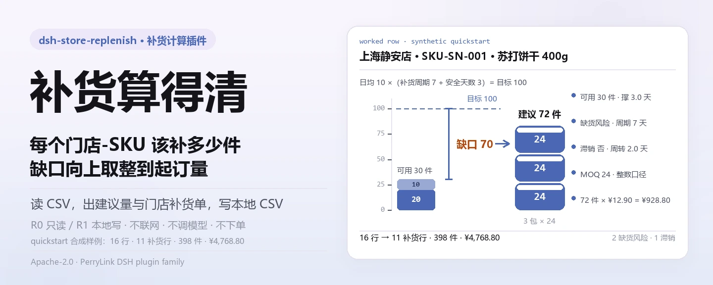
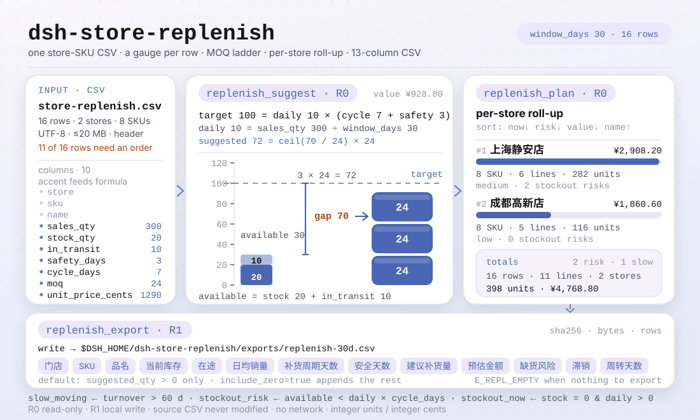
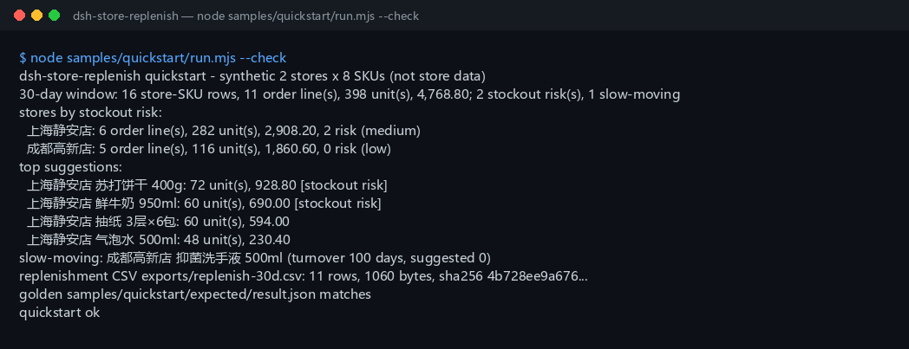

<div align="center">

<picture>
  <source media="(prefers-color-scheme: dark)" srcset="docs/assets/dsh-store-replenish-hero-zh-dark.webp">
  
</picture>

# dsh-store-replenish

**把门店-商品销售库存表变成按 SKU 的补货建议、按门店汇总的补货单和补货 CSV。**

面向 DeepSeek Harness 的补货计算插件：用「日均销量 ×（补货周期 + 安全天数）− 当前库存 − 在途」算出目标缺口，向上取整到起订量，顺手标出滞销与缺货风险；纯本地、零运行时依赖、不联网、不下采购单。

[安装](#三步上手) · [配置](#配置) · [FAQ](#faq) · [简体中文](README.md) · [English](README.en.md) · [Español](README.es.md) · [Português](README.pt.md) · [हिन्दी](README.hi.md)

[](LICENSE)
[](#兼容性)
[](https://www.npmjs.com/package/dsh-store-replenish)
[](https://github.com/PerryLink/dsh-store-replenish/actions/workflows/ci.yml)
[](#兼容性)

[](https://github.com/PerryLink/dsh-store-replenish/stargazers)
[](https://www.npmjs.com/package/dsh-store-replenish)
[](https://dshfind.com/plugins/PerryLink/dsh-store-replenish?ref=badge)

```sh
dsh plugin --profile <profile> add dsh-store-replenish
```

</div>

<sub>社区插件，与 DeepSeek 官方无关。唯一仓库：<https://github.com/PerryLink/dsh-store-replenish>。状态：alpha · 仅用公开/合成数据验证 · 非 GA——不含门店数据、商品数据或销售证据，不作生产可用、采购或财务结论声明。</sub>

## 它是什么

读入用户指定的门店-SKU 销售库存 CSV，按一条可复核的规则算出每个门店-SKU 的建议补货量：日均销量 ×（补货周期 + 安全天数）得到目标库存，减去当前库存与在途，把缺口向上取整到起订量；再按门店汇总成补货单，需要时写成补货 CSV 落到本地。周转超过 60 天的滞销 SKU 与「库存撑不到下次到货」的缺货风险都会被标出来，但下单、调拨、对接 ERP/POS/WMS 一件都不做——它只给建议和一张可交给人复核的表。

- **适合**：几十到几千个门店-SKU 组合的日常补货；需要把「日均销量、当前库存、在途、安全天数、补货周期、起订量」固定成一套可复核的算法；需要按门店汇总 SKU 数、总件数和预估金额；需要先看缺货风险再决定补货顺序；需要把补货单交给店长、采购或仓库复核。
- **不适合**：自动下采购单、自动调拨或对接 ERP / POS / WMS；多仓、多币种、税率或含税价换算；促销、季节、保质期、批次或效期建模；EOQ、持有成本、服务水平或安全库存优化（安全天数由你输入）；直接读 Excel / PDF / 图片（请先导出成 CSV）；把建议当成采购承诺。

<picture>
  <source media="(prefers-color-scheme: dark)" srcset="docs/assets/dsh-store-replenish-flow-v5-dark.svg">
  
</picture>

## 三步上手

1. **安装**（三选一）：

   ```sh
   # npm 通道（推荐，已发布版本）
   dsh plugin --profile <profile> add dsh-store-replenish
   # git 通道（最新 main；等价于 git+https://github.com/PerryLink/dsh-store-replenish.git）
   dsh plugin --profile <profile> add github:PerryLink/dsh-store-replenish
   # tarball 通道：本仓库 pnpm pack 后
   dsh plugin --profile <profile> add ./dsh-store-replenish-<version>.tgz
   ```

2. **最小配置**：没有插件级配置键——`cordis.patch.yml` 只 `insert` 一行，默认即可用；需要改的只有环境变量与工具参数（见「配置」）。

   ```yaml
   - insert:
       - id: dsh-store-replenish
         name: dsh-store-replenish
   ```

3. **验证已生效**：

   ```sh
   dsh --profile <profile> --dump-config | grep dsh-store-replenish
   node samples/quickstart/run.mjs --check
   ```

   quickstart 用随包的合成样例（2 门店 × 8 SKU）跑一遍完整链路，结尾应输出：

   ```text
   dsh-store-replenish quickstart - synthetic 2 stores x 8 SKUs (not store data)
   30-day window: 16 store-SKU rows, 11 order line(s), 398 unit(s), 4,768.80; 2 stockout risk(s), 1 slow-moving
   golden samples/quickstart/expected/result.json matches
   quickstart ok
   ```

**卸载**：`dsh plugin --profile <profile> remove dsh-store-replenish`（或从 profile patch 删掉该行）。

<details>
<summary>从 DSH Desktop 市场安装</summary>

所有 PerryLink 插件均可在 DSH Desktop 内置市场中浏览：**市场 → 来源 → 添加来源 → 粘贴** `https://perrylink-dsh-catalog.perrylink.workers.dev/catalog-source.json` **→ 选中**。安装仍需通过市场的 npm 身份校验与你的确认。

</details>

## 核心能力

- **按 SKU 的建议补货量** —— `replenish_suggest` 读门店-SKU 销售库存 CSV，按日均销量、补货周期、安全天数、当前库存、在途与起订量算出每个门店-SKU 的建议补货量，并给出日均销量、可用天数、周转天数、目标量、缺口、预估金额与三个标记。
- **按门店的补货单** —— `replenish_plan` 把建议汇总成每店一张单：SKU 数、补货行数、总件数、预估金额、缺货风险数与滞销数，门店按缺货风险排序，且保留每个 SKU 的明细。
- **可复核的本地 CSV** —— `replenish_export` 把补货单写成固定 13 列的 CSV 到 `$DSH_HOME/dsh-store-replenish/exports/`，返回路径、`sha256`、字节数与行数；默认只写建议量 > 0 的 SKU。
- **滞销与缺货风险标记** —— 周转超过 60 天标 `slow_moving`；库存 + 在途撑不到下一次补货标 `stockout_risk`；库存已经是 0 且仍有销量标 `stockout_now`。
- **稳定排序** —— 门店与 SKU 的次序完全由规则决定（风险 → 金额 → 名称 / SKU），同一份输入每次得到同一份输出，便于复核与存档。
- **整数口径** —— 件数是整数，金额是整数分；MOQ 取整用整数分子/分母，正好整倍的情形不会被浮点误差多推一档。
- **纯本地** —— 源码中没有 `fetch` / HTTP / DNS / WebSocket 调用；`package.json` 的演示元数据声明 `network: false`、`external: []`。

### 工具面

工具名是稳定 API；说明保留英文以匹配运行时输出。只读工具标 **R0**，本地写工具标 **R1**。

| 工具 | 用途 | 风险 |
|---|---|---|
| `replenish_suggest` | 读取门店-SKU 销售库存 CSV，按日均销量、补货周期、安全天数、库存、在途和 MOQ 算每个 SKU 的建议补货量，并标记滞销与缺货风险 | R0 只读 |
| `replenish_plan` | 按门店汇总补货单（SKU 数、补货行数、总件数、预估金额、风险数），按缺货风险排序 | R0 只读 |
| `replenish_export` | 导出补货单 CSV（门店/SKU/品名/库存/在途/日均/周期/安全天数/建议量/金额/风险/滞销/周转），返回路径与 sha256 | R1 本地写 |

### 输入

- **格式**：UTF-8 CSV，首行表头，逗号分隔；支持 RFC 4180 引号、嵌入换行、CRLF 与 UTF-8 BOM。
- **表头**：`store,sku,name,sales_qty,stock_qty,in_transit,safety_days,cycle_days,moq,unit_price_cents`。也接受中文别名（`门店 / SKU / 品名 / 销量 / 当前库存 / 在途 / 安全天数 / 补货周期天数 / 起订量 / 单价分`）；`name`（品名）可省略，省略时用 SKU 代替；多出的列会被忽略。
- **销量窗口**：`sales_qty` 是**统计窗口内**的累计销量，单位与库存一致（件/瓶/包）。窗口由工具的 `window_days` 声明，默认 30 天。
- **数值**：销量、当前库存、在途、安全天数、补货周期天数、起订量、单价分都必须是**非负整数**；起订量至少 1；安全天数与补货周期天数上限 3650；单价是整数**分**。负数、小数、空值或超范围一律 `E_REPL_QTY`。
- **门店-SKU**：同一文件内 `(门店, SKU)` 不能重复；不同门店可以卖同一个 SKU。
- **大小与来源**：单个文件 ≤ 20 MB，超过请按门店或品类拆文件；来源是用户自己指定的本地 CSV，原文件只读，不会被修改。

### 输出

- **`replenish_suggest`**：`{ window_days, source_sha256, totals, items }`。每个 SKU 有日均销量、可用天数、周转天数、目标量、缺口、建议补货量、预估金额，以及 `slow_moving`、`stockout_risk`、`stockout_now` 三个标记。`items` 按门店、风险、建议量、SKU 稳定排序。
- **`replenish_plan`**：`{ window_days, source_sha256, totals, stores }`。按门店汇总 `sku_count`（该店 SKU 数）、`order_lines`（需要补货的 SKU 数）、`total_units`（总件数）、`estimated_value_cents`（预估金额分）、缺货风险数、滞销数、`risk_level`（high/medium/low）；门店按缺货风险排序，并保留每个 SKU 的明细。
- **`replenish_export`**：把补货单写成 CSV 到 `$DSH_HOME/dsh-store-replenish/exports/`，列固定为 `门店,SKU,品名,当前库存,在途,日均销量,补货周期天数,安全天数,建议补货量,预估金额,缺货风险,滞销,周转天数`；返回路径、`sha256`、字节数和行数。默认只导出建议量 > 0 的 SKU；`include_zero=true` 时追加其余 SKU，便于复核「为什么没补」。

### 规则

1. 日均销量 = `sales_qty / window_days`；`window_days` 默认 30，允许 1–3650。它声明 CSV 里的销量代表多少天，不会自动去查历史。
2. 目标库存 = `日均销量 × (cycle_days + safety_days)`。
3. 缺口 = `目标库存 − 当前库存 − 在途`；在途计入可用库存。
4. 建议补货量 = 缺口 ≤ 0 时取 0；否则 `ceil(缺口 / moq) × moq`。MOQ 取整用整数分子/分母计算，避免浮点误差把正好整倍的情形多推一档。
5. 周转天数 = `当前库存 / 日均销量`；库存 > 0 且周转 > 60 天标为滞销。无销量但有库存时周转为 `null`（视为无穷大），同样标滞销；无销量且无库存不标。
6. 缺货风险 = `当前库存 + 在途 < 日均销量 × cycle_days`，即现有可用库存撑不到下一次补货到货。当前库存为 0 且日均 > 0 时另有 `stockout_now=true`。
7. 门店排序：`stockout_now` 数降序 → 缺货风险数降序 → 预估金额降序 → 门店名升序。缺货风险优先于金额，所以金额更小的门店也可能排在前面。
8. 门店内排序：`stockout_now` → 缺货风险 → 需要补货 → 滞销 → 其他；同档按建议量降序、SKU 升序。
9. 预估金额 = `建议补货量 × 单价分`；CSV 里格式化为两位小数，API 里仍是整数分。
10. `replenish_export` 默认只写建议量 > 0 的 SKU；若一行都没有则报 `E_REPL_EMPTY`，传 `include_zero=true` 可导出全量 SKU（此时建议量为 0 的行也写入，`order_lines` 仍只数建议量 > 0 的行）。

### 示例

直接复制下面这句（`package.json` 的 `dsh.demo.prompt`）：

```text
用这份 2 门店 × 8 SKU 的销售库存表，按 30 天窗口算补货建议，汇总成门店补货单并导出补货 CSV。
```

用自带样例复跑并核对金标（真实运行，截图即来自这条命令）：

```sh
node samples/quickstart/run.mjs --check
```



样例是 16 行合成数据（2 家门店 × 8 个 SKU），含 1 个滞销 SKU（成都高新店 `抑菌洗手液 500ml`，周转 100 天）和 2 个缺货风险 SKU（上海静安店 `苏打饼干 400g`、`鲜牛奶 950ml`）。样例同时覆盖 MOQ 正好整倍（`每日坚果` 12 → 12）与非整倍（`苏打饼干` 70 → 72）、缺口正好为 0（上海 `成猫粮`）和完全无销量（成都 `抑菌洗手液`）。金标 `samples/quickstart/expected/result.json` 由 `node samples/quickstart/run.mjs --json` 真实产生，不是手写；截图是 `--check` 的真实终端输出，命令与输出哈希记录在 `screenshots.json`。

*Observed from `src/plugin/tools.ts:159-168`（`replenish_suggest` 的渲染行）与 `docs/assets/quickstart.log`*

## 实测数据

公开 / 合成验收由 `node scripts/gate.mjs` 重跑（`scripts/lint.mjs` + `scripts/acceptance.mjs` + `ACCEPTANCE.csv` 逐行 `pass=true`），明细落在 `ACCEPTANCE.csv`。当前记录：

- **测试**：`node --test test/*.test.mjs` → 121 项通过，0 失败（15 个测试文件）。
- **门禁**：`node scripts/lint.mjs` → 9 个源文件 / 15 个测试文件 / 121 项测试 / 16 个发布条目；`node scripts/gate.mjs` → `gate ok: 16 acceptance rows`。
- **金标**：`node samples/quickstart/run.mjs --check` → `golden samples/quickstart/expected/result.json matches`。
- **样例口径**：30 天窗口下 16 行门店-SKU → 11 个补货行、398 件、预估 4,768.80；上海静安店 6 行 / 282 件 / 2 个缺货风险（medium），成都高新店 5 行 / 116 件 / 0 风险（low）。

`ACCEPTANCE.csv` 的 16 行原样引用（完整文件另含 `script` 与 `evidence_sha256` 两列）：

```csv
req_id,metric,threshold,actual,pass,source,counted
AC-R01,suggest totals,rows=16 stores=2 unique_skus=8 order_lines=11 units=398 value=476880 risk=2 slow=1,rows=16 stores=2 unique_skus=8 order_lines=11 units=398 value=476880 risk=2 slow=1,true,public/synthetic,false
AC-R02,MOQ rounding,苏打=72 牛奶=60 乌龙=30 坚果=12,苏打=72 牛奶=60 乌龙=30 坚果=12,true,public/synthetic,false
AC-R03,stockout and slow flags,risk=上海静安店/SKU-DA-001|上海静安店/SKU-SN-001 slow=成都高新店/SKU-HH-002 now=0,risk=上海静安店/SKU-DA-001|上海静安店/SKU-SN-001 slow=成都高新店/SKU-HH-002 now=0,true,public/synthetic,false
AC-R04,store aggregation,上海=8/6/282/290820/2/medium 成都=8/5/116/186060/0/low,上海=8/6/282/290820/2/medium 成都=8/5/116/186060/0/low,true,public/synthetic,false
AC-R05,store risk order,order=上海静安店/成都高新店,order=上海静安店/成都高新店,true,public/synthetic,false
AC-R06,plan equals suggest totals,totals=same source=same,totals=same source=same,true,public/synthetic,false
AC-R07,replenishment CSV,rows=11 lines=12 stores=2 units=398 value=476880 header=ok hash=ok,rows=11 lines=12 stores=2 units=398 value=476880 header=ok hash=ok,true,public/synthetic,false
AC-R08,include zero,rows=16 slow=1,rows=16 slow=1,true,public/synthetic,false
AC-R09,15-day window,order_lines=14 units=1774 risk=13,order_lines=14 units=1774 risk=13,true,public/synthetic,false
AC-R10,bad quantity,E_REPL_QTY,E_REPL_QTY,true,public/synthetic,false
AC-R11,missing column,E_REPL_CSV_ROW,E_REPL_CSV_ROW,true,public/synthetic,false
AC-R12,empty table,E_REPL_EMPTY,E_REPL_EMPTY,true,public/synthetic,false
AC-R13,export path safety,E_REPL_PATH_INVALID,E_REPL_PATH_INVALID,true,public/synthetic,false
AC-R14,no order to export,E_REPL_EMPTY then rows=1,E_REPL_EMPTY then rows=1,true,public/synthetic,false
AC-R15,first CSV row,上海静安店|SKU-SN-001|苏打饼干 400g|20|10|10.00|7|3|72|928.80|是|否|2.0,上海静安店|SKU-SN-001|苏打饼干 400g|20|10|10.00|7|3|72|928.80|是|否|2.0,true,public/synthetic,false
PS1-QS01,quickstart golden,1/1,1,true,synthetic/quickstart,true
```

除 `PS1-QS01`（随包样例的本地复现，`counted=true`）外，其余 15 行都是公开 / 合成 fixture 检查（`counted=false`）：不是门店运行，没有编造输出。环境与哈希记录见 [`EVIDENCE.md`](EVIDENCE.md)。

## 配置

本插件没有 Schemastery 配置键：`cordis.patch.yml` 只 `insert` 一行（`id: dsh-store-replenish`），默认即可用。真正可调的是两个环境变量与四个工具参数。

| 变量 | 默认值 | 含义 |
|---|---|---|
| `DSH_HOME` | 宿主进程的 cwd | 本地写根目录的基目录；导出落在 `<DSH_HOME>/dsh-store-replenish/exports/`，未设时退回 `cwd/dsh-store-replenish/exports/` |
| `DSH_STORE_REPLENISH_HOME` | 未设置 | 直接覆盖本地写根目录（测试用）；设置后 `exports/` 挂在它下面，不再拼 `dsh-store-replenish` |

最常用的工具参数：

| 参数 | 默认值 | 作用于 | 含义 |
|---|---|---|---|
| `path` | 必填 | 三个工具 | 用户指定的门店-SKU 销售库存 CSV 路径；只读，不会被改写 |
| `window_days` | `30` | 三个工具 | `sales_qty` 代表多少天的累计销量，1–3650；超范围 `E_REPL_QTY` |
| `filename` | `replenish-<window_days>d.csv` | `replenish_export` | 导出文件名，必须匹配 `^[A-Za-z0-9._-]{1,120}$`，且解析后必须落在 `exports/` 内 |
| `include_zero` | `false` | `replenish_export` | `true` 时把建议量为 0 的 SKU 也写进补货单，便于复核「为什么没补」 |

<details>
<summary>错误码与故障排查</summary>

| 错误码 | 何时出现 | 下一步 |
|---|---|---|
| `E_REPL_QTY` | 销量/库存/在途/安全天数/补货周期/起订量/单价为负数、小数、空值、超范围；起订量为 0；`window_days` 不在 1–3650 | 所有数值填非负整数，起订量至少 1，窗口 1–3650 |
| `E_REPL_CSV_ROW` | 列数不对、表头缺失或重复、门店/SKU 为空、同一门店-SKU 重复、文件超过 20 MB | 对照表头修这一行；`(门店, SKU)` 只能出现一次 |
| `E_REPL_EMPTY` | CSV 为空/只有表头；导出时没有任何建议量 > 0 的 SKU | 确认 CSV 有数据行；要看全量 SKU 时传 `include_zero=true` |
| `E_REPL_PATH_INVALID` | 输入路径不存在/是目录/读不了，导出文件名含路径、空格、中文或超长，或写文件失败 | 传存在的 CSV；导出只传 `[A-Za-z0-9._-]` 文件名 |

报错原文格式：`<一句人话>（E_REPL_XXX）｜下一步：<一个动作>｜细节：<可选>`。按症状 / 原因 / 动作组织的排查步骤见 [`TROUBLESHOOTING.md`](TROUBLESHOOTING.md)。

</details>

## FAQ

<details>
<summary>为什么建议量和手工算的差一箱？</summary>

因为向上取整到起订量。例如缺口 70、起订量 24，`ceil(70/24)=3`，建议 72 而不是 70。看 `raw_qty`（缺口）和 `moq` 就能对出来；`suggested_qty` 一定是 MOQ 的整数倍。

</details>

<details>
<summary>滞销 SKU 还会建议补货吗？</summary>

公式优先：如果缺口 > 0，仍会给出建议，同时 `slow_moving=true` 提醒你先处理库存。实际业务里通常先核对滞销原因；本包只标记，不自动把滞销 SKU 归零，也不替你做停采决定。

</details>

<details>
<summary>`window_days` 是「最近 N 天」自动取数吗？</summary>

不是。它声明 CSV 里 `sales_qty` 代表多少天的累计销量。传 15 就是把同一列解释成 15 天销量，日均会相应变大。工具不会去读历史数据或调用任何系统。

</details>

<details>
<summary>在途算库存吗？算周转吗？</summary>

在途计入可用库存（公式里减掉，也参与缺货风险判断），但**不计入周转天数**。周转只看当前库存与日均销量。

</details>

<details>
<summary>`stockout_risk` 和 `stockout_now` 有什么区别？</summary>

`stockout_now` 表示当前库存已经是 0 且仍有销量；`stockout_risk` 表示当前库存 + 在途撑不到下次补货到货（`< 日均 × cycle_days`）。在途很多时可能 `stockout_now=true` 但 `stockout_risk=false`。

</details>

<details>
<summary>会改我的文件或上传数据吗？</summary>

不会。只读用户指定的 CSV；只在本地写 `$DSH_HOME/dsh-store-replenish/exports/`；不联网、不调用模型、不上传。原 CSV 不会被改写。

</details>

<details>
<summary>能直接读 Excel 或对接采购系统吗？</summary>

不能。只接受 CSV，不生成采购订单、不调用 ERP/POS/WMS、不发送任何消息。需要下单时，把导出的 CSV 交给现有流程并人工复核。

</details>

## 安全边界

- **不联网、不调模型。** 源码中没有 `fetch` / HTTP / DNS / WebSocket 调用；`package.json` 的演示元数据声明 `network: false`、`external: []`。输入与输出都留在本地。
- **源文件只读。** 只读用户指定的 CSV，绝不改写；写操作只落在 `<DSH_HOME>/dsh-store-replenish/exports/` 下的补货 CSV。
- **导出路径有界。** 文件名必须匹配 `^[A-Za-z0-9._-]{1,120}$`；路径解析后必须落在 `exports/` 的 `realpath` 之下，越界、符号链接改道与绝对路径一律 `E_REPL_PATH_INVALID`。
- **输入有界。** 单文件 ≤ 20 MB；空文件 `E_REPL_EMPTY`；目录或不可读 `E_REPL_PATH_INVALID`；列数、表头与重复门店-SKU 不合规 `E_REPL_CSV_ROW`。
- **整数口径。** 件数与金额都用整数（金额为分），MOQ 取整用整数分子/分母，避免浮点误差把正好整倍的情形多推一档。
- **失败响亮、无隐藏面。** 四类错误码统一成一句人话 + 一个下一步；不静默降级、不给假数据。不注册命令、客户端 slot、`webServer` 路由或服务键，宿主只注入 `tools`。

## 权限与数据

- 读：用户指定的门店-商品销售库存 CSV（样例 `samples/quickstart/input/store-replenish.csv`）；不读其他目录。
- 写：`$DSH_HOME/dsh-store-replenish/exports/`（补货单 CSV）；不改原 CSV。
- 联网：否。
- 外部系统：无。
- **风险等级**：`replenish_suggest` 与 `replenish_plan` 标 **R0**（只读）；`replenish_export` 标 **R1**（本地写，只写 `exports/`）。测试可用 `DSH_STORE_REPLENISH_HOME` 覆盖本地写根目录，默认严格等于 `$DSH_HOME/dsh-store-replenish`。
- **数据边界**：仅公开 / 合成样例；不含门店数据、商品数据或销售证据。

## 已知限制

- **不下单、不调拨**：只给建议和本地 CSV；不接采购、ERP、POS、WMS，不发送任何消息。
- **单仓单币种**：输入没有仓库、币种或税率列；多仓/多币种请拆文件或在源系统折算。
- **安全天数由你给**：不做需求预测、季节性、促销、服务水平或 EOQ 优化；安全天数与补货周期是输入，不是模型输出。
- **不做效期/批次**：不建模保质期、批次、序列号、先进先出或损耗。
- **销量窗口是声明的**：`sales_qty` 代表 `window_days` 天的累计销量；工具不会自动取历史数据。
- **周转是标记不是决策**：滞销只按 60 天阈值标记；是否停采、清仓或退货由你决定。
- **CSV only**：不读 Excel / PDF / 图片，不做 OCR。
- **不做公式注入清洗**：导出 CSV 只做 RFC 4180 引号转义，不做 Excel 公式前缀清洗；不要用 Excel 直接打开来源不明的 CSV。
- **整数计量**：数值按整数件与整数分处理；不处理拆零、称重或小数计量。
- **仅公开 / 合成样例**：alpha / partial、not counted，不作 GA 或生产可用声明；`ACCEPTANCE.csv` 只有 `PS1-QS01` 是 `counted=true`。

## 与其他 DSH 插件的互操作性

本插件**不干扰**其他插件：

- **工具名带命名空间。** 三个工具都在 `replenish_*` 下，不占用内置工具或其他插件的裸名。
- **不抢宿主表面。** 不注册命令、客户端 slot、`webServer` 路由或服务键；`inject` 只有 `tools`，工具存在与否都按宿主契约判断。
- **patch 层只 `insert`。** `cordis.patch.yml` 只插入自己那一行，从不覆写内置行的 `config`。
- **无全局改写。** 不改原型、不替换全局 fetch dispatcher；只读取 `DSH_HOME` 与 `DSH_STORE_REPLENISH_HOME` 两个环境变量。
- **职责互补。** 商品主数据校验交给 [`dsh-pim-lint`](https://github.com/PerryLink/dsh-pim-lint)，商品上架检查交给 [`dsh-pim-listing`](https://github.com/PerryLink/dsh-pim-listing)；它们各自是独立包，按需安装。

## 兼容性

| 维度 | 状态 |
|---|---|
| Harness | DeepSeek Harness `>=0.2.1-rc.3 <0.4.0`（`package.json` 的 `engines.dsh`） |
| Node | `>=24.9.0 <25`（`.nvmrc`：24） |
| 平台 | 任何 DSH 可运行处；仅本地文件 |
| 数据 | 不联网、不调用模型、不上传 |

## 生态与质量

- [dshfind 插件页](https://dshfind.com/plugins/PerryLink/dsh-store-replenish)（安装量与排名）
- 文档：[`TROUBLESHOOTING.md`](TROUBLESHOOTING.md)（按症状 / 原因 / 动作排查）· [`EVIDENCE.md`](EVIDENCE.md)（环境、命令结果与哈希）
- 索引：[领域索引](https://perrylink.github.io/dsh-plugins/) · [生态实测知识库](https://perrylink.github.io/dsh-plugin-guide/)（插件开发指南 · 选型实测数据 · 维护取舍判据）

### 相关项目

- [dsh-pim-lint](https://github.com/PerryLink/dsh-pim-lint)（商品主数据校验）· [dsh-pim-listing](https://github.com/PerryLink/dsh-pim-listing)（商品上架检查）

## 开发

```sh
pnpm install --frozen-lockfile
pnpm build && pnpm lint && pnpm typecheck
node --test test/*.test.mjs
node scripts/gate.mjs                    # lint + acceptance + ACCEPTANCE.csv 逐行 pass
node samples/quickstart/run.mjs --check  # 合成样例，应输出 quickstart ok
```

TypeScript 源码在 `src/`（`src/core/` 负责 CSV 解析、补货计算、MOQ 取整、整数分金额、导出与路径安全；`src/plugin/` 负责宿主面与工具注册），构建产物在 `lib/`；随包样例在 `samples/quickstart/`。当前版本 `0.2.0`（与 `package.json` 一致）。测试用 `node --test test/*.test.mjs`；公开样本缺失导致的 skip 属正常，不是失败。

开头 hero 与结构图都由 [`scripts/gen-readme-assets.py`](scripts/gen-readme-assets.py) 程序化生成（hero 用 Python + Pillow 渲染成 1440×576 的 webp，结构图是手写 SVG，缺 CJK 字体会直接报错退出）：`python scripts/gen-readme-assets.py` 可重复执行，输出 `docs/assets/dsh-store-replenish-hero-{zh,en}-{light,dark}.webp` 与 `docs/assets/dsh-store-replenish-flow-v5-{light,dark}.svg`；图里的数字直接读 `samples/quickstart/expected/result.json`，不会和金标漂移。本仓没有 benchmark 数据集，因此不画 evidence 图。

Topics：`deepseek-harness`, `dsh`, `dsh-plugin`, `retail`, `replenishment`, `inventory`, `stockout`, `store-ops`, `csv`, `perrylink`

## 家族与致谢

本项目是 [PerryLink](https://github.com/PerryLink) 维护的 DeepSeek Harness 插件家族成员（全部 Apache-2.0）。如果这个插件帮到了你，**给个 star**——它不解锁任何功能，但会让下一个人更容易找到它。

- [@PerryLink](https://github.com/PerryLink) —— 创建者与维护者：补货公式与 MOQ 整数取整、门店排序与风险标记、固定 13 列补货 CSV、quickstart 与验收套件、五语文档。

## License

[LICENSE](LICENSE)（Apache License 2.0）© 2026 dsh-store-replenish contributors；另见 `NOTICE` 与 `THIRD-PARTY-NOTICES`。

<p align="center"><sub>Apache-2.0 · 社区插件，与 DeepSeek 无关。</sub></p>
