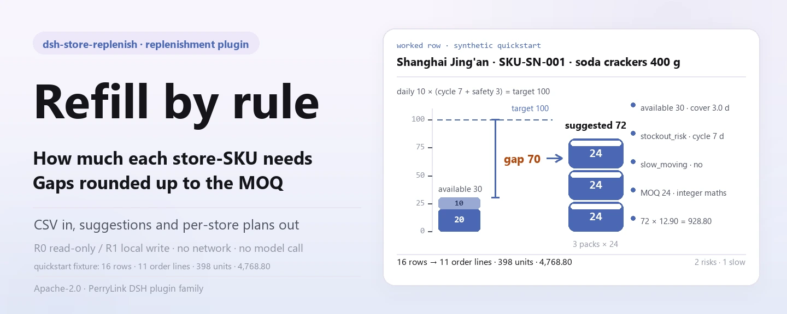
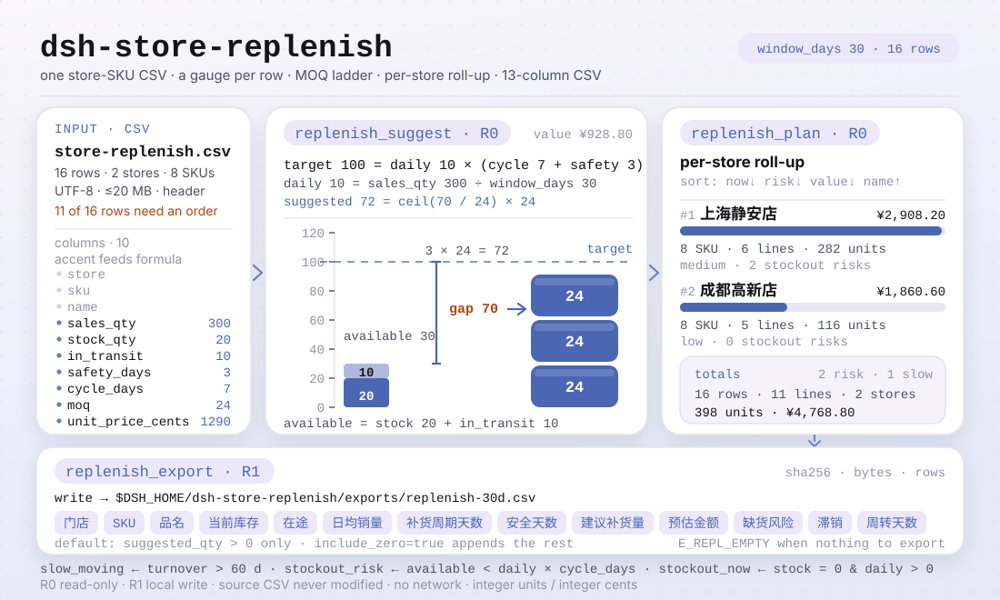

<div align="center">

<picture>
  <source media="(prefers-color-scheme: dark)" srcset="docs/assets/dsh-store-replenish-hero-en-dark.webp">
  
</picture>

# dsh-store-replenish

**Transforma uma tabela CSV de vendas e estoque por loja-SKU em sugestões de reposição por SKU, pedidos de reposição por loja e um CSV de reposição.**

Plugin de cálculo de reposição para o DeepSeek Harness: `média diária × (dias de ciclo + dias de segurança) − estoque − em trânsito`, arredondada para cima até o MOQ, com marcação de baixo giro e de risco de ruptura. Tudo local, sem dependências em tempo de execução, sem rede e sem gerar pedidos de compra.

[Instalação](#instalação-em-três-passos) · [Configuração](#configuração) · [FAQ](#faq) · [简体中文](README.md) · [English](README.en.md) · [Español](README.es.md) · [Português](README.pt.md) · [हिन्दी](README.hi.md)

[](LICENSE)
[](#compatibilidade)
[](https://www.npmjs.com/package/dsh-store-replenish)
[](https://github.com/PerryLink/dsh-store-replenish/actions/workflows/ci.yml)
[](#compatibilidade)

[](https://github.com/PerryLink/dsh-store-replenish/stargazers)
[](https://www.npmjs.com/package/dsh-store-replenish)
[](https://dshfind.com/plugins/PerryLink/dsh-store-replenish?ref=badge)

```sh
dsh plugin --profile <profile> add dsh-store-replenish
```

</div>

<sub>Plugin da comunidade, sem vínculo com a DeepSeek. Repositório único: <https://github.com/PerryLink/dsh-store-replenish>. Estado: alpha · apenas dados públicos/sintéticos · não GA — sem dados de loja, de produto ou evidência de vendas, e sem alegações de produção, compra ou finanças.</sub>

## O que é

Lê o CSV de vendas e estoque por loja-SKU indicado pelo usuário e calcula uma quantidade sugerida por loja-SKU com uma única regra auditável: a média diária × (dias de ciclo + dias de segurança) dá o estoque alvo, subtraem-se o estoque e o trânsito, e a lacuna é arredondada para cima até o MOQ. Agrega o resultado em um pedido por loja e, quando é preciso um arquivo, escreve um CSV local. SKUs com giro acima de 60 dias são marcados como baixo giro, e SKUs cuja disponibilidade não cobre o próximo ciclo são marcados como risco de ruptura; mas não emite pedidos, não transfere e não integra com ERP/POS/WMS. Entrega uma sugestão e uma tabela revisável, nada além disso.

- **Serve:** de dezenas a milhares de combinações loja-SKU; fixar uma regra auditável para média diária, estoque, trânsito, dias de segurança, dias de ciclo e MOQ; contagens por loja, unidades totais e valor estimado; decidir a ordem de reposição pelo risco de ruptura; uma lista de reposição para o responsável da loja, o comprador ou o armazém revisar.
- **Não serve:** emitir pedidos de compra, transferências ou integração com ERP/POS/WMS; multiarmazém, multimoeada, impostos ou preços com imposto; promoções, sazonalidade, validade, lotes ou vencimento; EOQ, custo de carregamento, nível de serviço ou otimização de estoque de segurança (os dias de segurança são uma entrada); ler Excel/PDF/imagens diretamente (exporte antes para CSV); tratar a sugestão como compromisso de compra.

<picture>
  <source media="(prefers-color-scheme: dark)" srcset="docs/assets/dsh-store-replenish-flow-v5-dark.svg">
  
</picture>

## Instalação em três passos

1. **Instalar** (escolha um canal):

   ```sh
   # canal npm (recomendado, versões publicadas)
   dsh plugin --profile <profile> add dsh-store-replenish
   # canal git (último main; equivale a git+https://github.com/PerryLink/dsh-store-replenish.git)
   dsh plugin --profile <profile> add github:PerryLink/dsh-store-replenish
   # canal tarball: pnpm pack neste repositório e depois
   dsh plugin --profile <profile> add ./dsh-store-replenish-<version>.tgz
   ```

2. **Configuração mínima**: não há chaves de configuração do plugin — o `cordis.patch.yml` apenas `insert`a uma linha e os padrões funcionam. O que se ajusta são duas variáveis de ambiente e os argumentos das ferramentas (ver «Configuração»).

   ```yaml
   - insert:
       - id: dsh-store-replenish
         name: dsh-store-replenish
   ```

3. **Verificar se está montado**:

   ```sh
   dsh --profile <profile> --dump-config | grep dsh-store-replenish
   node samples/quickstart/run.mjs --check
   ```

   O quickstart executa a amostra sintética incluída (2 lojas × 8 SKUs) por toda a cadeia e deve terminar com:

   ```text
   dsh-store-replenish quickstart - synthetic 2 stores x 8 SKUs (not store data)
   30-day window: 16 store-SKU rows, 11 order line(s), 398 unit(s), 4,768.80; 2 stockout risk(s), 1 slow-moving
   golden samples/quickstart/expected/result.json matches
   quickstart ok
   ```

**Desinstalar**: `dsh plugin --profile <profile> remove dsh-store-replenish` (ou remova a linha do patch do perfil).

<details>
<summary>Instalar pelo mercado do DSH Desktop</summary>

Todos os plugins PerryLink estão no mercado integrado do DSH Desktop: **Mercado → Fontes → Adicionar fonte → colar** `https://perrylink-dsh-catalog.perrylink.workers.dev/catalog-source.json` **→ selecionar**. A instalação continua exigindo a verificação de identidade npm do mercado e a sua confirmação.

</details>

## Capacidades principais

- **Sugestões por SKU** — `replenish_suggest` lê o CSV loja-SKU e calcula a quantidade sugerida de cada SKU a partir da média diária, dias de ciclo, dias de segurança, estoque, trânsito e MOQ, devolvendo média diária, dias de cobertura, dias de giro, quantidade alvo, lacuna, valor estimado e três marcações.
- **Pedidos por loja** — `replenish_plan` agrega as sugestões em um pedido por loja: número de SKUs, linhas de pedido, unidades totais, valor estimado, contagens de risco e de baixo giro, ordenado por risco de ruptura e mantendo o detalhe de cada SKU.
- **CSV local revisável** — `replenish_export` grava o pedido como CSV de 13 colunas fixas em `$DSH_HOME/dsh-store-replenish/exports/` e devolve caminho, `sha256`, bytes e contagens de linhas; por padrão só grava SKUs com quantidade sugerida positiva.
- **Marcações de baixo giro e ruptura** — giro acima de 60 dias ativa `slow_moving`; estoque + trânsito que não cobrem o próximo ciclo ativa `stockout_risk`; estoque já em 0 com demanda ativa `stockout_now`.
- **Ordem determinística** — a ordem de lojas e SKUs é definida por regras (risco → valor → nome / SKU), então a mesma entrada gera sempre a mesma saída e pode ser revisada ou arquivada.
- **Aritmética inteira** — as unidades são inteiras e o dinheiro são centavos inteiros; o arredondamento ao MOQ usa numerador/denominador inteiros, de modo que um múltiplo exato nunca pula de faixa por erro de ponto flutuante.
- **Apenas local** — não há nenhuma chamada `fetch` / HTTP / DNS / WebSocket no código; os metadados de demonstração do `package.json` declaram `network: false` e `external: []`.

### Superfície de ferramentas

Os nomes das ferramentas são API estável (mantidos em inglês para coincidir com a saída do runtime). As de leitura são **R0**; a de escrita local é **R1**.

| Ferramenta | Uso | Risco |
|---|---|---|
| `replenish_suggest` | Lê o CSV loja-SKU e calcula a quantidade sugerida por SKU a partir de média diária, dias de ciclo, dias de segurança, estoque, trânsito e MOQ; marca baixo giro e risco de ruptura | R0 somente leitura |
| `replenish_plan` | Agrega um pedido de reposição por loja (número de SKUs, linhas, unidades, valor estimado, contagens de risco), ordenado por risco de ruptura | R0 somente leitura |
| `replenish_export` | Grava o CSV de reposição (loja/SKU/nome/estoque/trânsito/média/ciclo/segurança/sugerido/valor/risco/baixo giro/giro) e devolve caminho + sha256 | R1 escrita local |

### Entrada

- **Formato**: CSV UTF-8 com linha de cabeçalho e separador de vírgula; aceita aspas RFC 4180, quebras de linha internas, CRLF e BOM UTF-8.
- **Cabeçalho**: `store,sku,name,sales_qty,stock_qty,in_transit,safety_days,cycle_days,moq,unit_price_cents`. Também aceita apelidos de cabeçalho em chinês; `name` é opcional e cai para o SKU; colunas extras são ignoradas.

```text
store,sku,name,sales_qty,stock_qty,in_transit,safety_days,cycle_days,moq,unit_price_cents
门店,SKU,品名,销量,当前库存,在途,安全天数,补货周期天数,起订量,单价分
```

- **Janela de vendas**: `sales_qty` é a demanda acumulada **dentro da janela declarada**, na mesma unidade do estoque. A janela é o argumento `window_days` da ferramenta, padrão 30.
- **Números**: vendas, estoque, trânsito, dias de segurança, dias de ciclo, MOQ e preço unitário são inteiros não negativos; o MOQ é pelo menos 1; os dias de segurança e de ciclo têm limite de 3650; o preço é **centavos** inteiros. Valores negativos, fracionários, vazios ou fora da faixa são `E_REPL_QTY`.
- **Loja-SKU**: um par `(loja, SKU)` pode aparecer uma vez por arquivo; lojas diferentes podem vender o mesmo SKU.
- **Tamanho e origem**: até 20 MB por arquivo — acima disso, divida por loja ou categoria. A origem é o CSV local indicado pelo usuário; é somente leitura e nunca é modificado.

### Saída

- **`replenish_suggest`**: `{ window_days, source_sha256, totals, items }`. Cada SKU traz média diária, dias de cobertura, dias de giro, quantidade alvo, lacuna bruta, quantidade sugerida, valor estimado e as marcações `slow_moving`, `stockout_risk` e `stockout_now`. Os itens são ordenados de forma determinística por loja, risco, quantidade e SKU.
- **`replenish_plan`**: `{ window_days, source_sha256, totals, stores }`. Por loja: `sku_count`, `order_lines`, `total_units`, `estimated_value_cents`, contagens de risco e de baixo giro, e `risk_level` (high/medium/low). As lojas são ordenadas por risco de ruptura e mantêm o detalhe de cada SKU.
- **`replenish_export`**: grava o pedido de reposição como CSV em `$DSH_HOME/dsh-store-replenish/exports/` com cabeçalho fixo de 13 colunas, e devolve caminho, `sha256`, bytes e contagens de linhas. Por padrão só grava SKUs com quantidade sugerida positiva; `include_zero=true` acrescenta o restante para revisão.

```text
门店,SKU,品名,当前库存,在途,日均销量,补货周期天数,安全天数,建议补货量,预估金额,缺货风险,滞销,周转天数
```

### Regras

1. Média diária = `sales_qty / window_days`; `window_days` é 30 por padrão e aceita 1–3650. Ele declara o que a coluna de vendas significa; a ferramenta não busca histórico.
2. Estoque alvo = `média diária × (cycle_days + safety_days)`.
3. Lacuna = `alvo − estoque − em trânsito`; o trânsito conta como estoque disponível.
4. Quantidade sugerida = 0 quando a lacuna é ≤ 0; caso contrário `ceil(lacuna / moq) × moq`. O arredondamento ao MOQ usa aritmética inteira, então um múltiplo exato nunca pula de faixa por ponto flutuante.
5. Dias de giro = `estoque / média diária`; estoque > 0 com giro > 60 dias é baixo giro. Sem vendas mas com estoque dá `turnover_days: null` (infinito) e a marcação de baixo giro; sem vendas e sem estoque não marca.
6. Risco de ruptura = `estoque + em trânsito < média diária × cycle_days`, ou seja, a disponibilidade não cobre um ciclo completo. `stockout_now=true` significa ainda estoque 0 com demanda positiva.
7. Ordem de lojas: contagem de `stockout_now` desc → contagem de risco desc → valor desc → nome asc. O risco pesa mais que o valor, então uma loja menor pode ficar à frente.
8. Ordem dentro da loja: `stockout_now` → risco de ruptura → precisa de reposição → baixo giro → outros; dentro da faixa, quantidade desc e depois SKU asc.
9. Valor estimado = `quantidade sugerida × preço em centavos`; a API devolve centavos inteiros e o CSV mostra duas casas decimais.
10. `replenish_export` só grava quantidades sugeridas positivas; se não houver nenhuma linha assim, lança `E_REPL_EMPTY`. Com `include_zero=true` todos os SKUs são gravados, enquanto `order_lines` continua contando só as linhas positivas.

### Exemplos

Cole esta linha (é o `dsh.demo.prompt` incluído no `package.json`):

```text
用这份 2 门店 × 8 SKU 的销售库存表，按 30 天窗口算补货建议，汇总成门店补货单并导出补货 CSV。
```

Ou reproduza a amostra incluída e compare com o arquivo de referência (uma execução real — a captura vem deste comando):

```sh
node samples/quickstart/run.mjs --check
```


A amostra são 16 linhas sintéticas (2 lojas × 8 SKUs). Contém um SKU de baixo giro (Chengdu, álcool em gel 500 ml, giro 100 dias) e dois SKUs com risco de ruptura (Shanghai, biscoito de soda 400 g e leite fresco 950 ml). Também cobre um múltiplo exato de MOQ (12 → 12), um não múltiplo (70 → 72), uma lacuna exatamente zero (Shanghai, ração seca para gatos) e um SKU sem vendas (Chengdu, álcool em gel). O arquivo de referência `samples/quickstart/expected/result.json` é a saída real de `node samples/quickstart/run.mjs --json`, não escrito à mão; a captura é a saída real de `--check` e os hashes do comando e da saída estão em `screenshots.json`.

*Observed from `src/plugin/tools.ts:159-168` (a linha de render de `replenish_suggest`) e `docs/assets/quickstart.log`*

## Dados medidos

A suíte de aceitação pública/sintética é reproduzida com `node scripts/gate.mjs` (`scripts/lint.mjs` + `scripts/acceptance.mjs` + cada linha de `ACCEPTANCE.csv` com `pass=true`); o detalhe está em `ACCEPTANCE.csv`. Registro atual:

- **Testes**: `node --test test/*.test.mjs` → 121 passam, 0 falham (15 arquivos de teste).
- **Portões**: `node scripts/lint.mjs` → 9 arquivos de origem / 15 arquivos de teste / 121 testes / 16 entradas publicadas; `node scripts/gate.mjs` → `gate ok: 16 acceptance rows`.
- **Referência**: `node samples/quickstart/run.mjs --check` → `golden samples/quickstart/expected/result.json matches`.
- **Forma da amostra**: na janela de 30 dias, 16 linhas loja-SKU → 11 linhas de pedido, 398 unidades, 4.768,80 estimados; Shanghai 6 linhas / 282 unidades / 2 riscos de ruptura (medium), Chengdu 5 linhas / 116 unidades / 0 riscos (low).

As 16 linhas de `ACCEPTANCE.csv`, citadas literalmente (o arquivo completo traz ainda `script` e `evidence_sha256`):

```csv
req_id,metric,threshold,actual,pass,source,counted
AC-R01,suggest totals,rows=16 stores=2 unique_skus=8 order_lines=11 units=398 value=476880 risk=2 slow=1,rows=16 stores=2 unique_skus=8 order_lines=11 units=398 value=476880 risk=2 slow=1,true,public/synthetic,false
AC-R02,MOQ rounding,苏打=72 牛奶=60 乌龙=30 坚果=12,苏打=72 牛奶=60 乌龙=30 坚果=12,true,public/synthetic,false
AC-R03,stockout and slow flags,risk=上海静安店/SKU-DA-001|上海静安店/SKU-SN-001 slow=成都高新店/SKU-HH-002 now=0,risk=上海静安店/SKU-DA-001|上海静安店/SKU-SN-001 slow=成都高新店/SKU-HH-002 now=0,true,public/synthetic,false
AC-R04,store aggregation,上海=8/6/282/290820/2/medium 成都=8/5/116/186060/0/low,上海=8/6/282/290820/2/medium 成都=8/5/116/186060/0/low,true,public/synthetic,false
AC-R05,store risk order,order=上海静安店/成都高新店,order=上海静安店/成都高新店,true,public/synthetic,false
AC-R06,plan equals suggest totals,totals=same source=same,totals=same source=same,true,public/synthetic,false
AC-R07,replenishment CSV,rows=11 lines=12 stores=2 units=398 value=476880 header=ok hash=ok,rows=11 lines=12 stores=2 units=398 value=476880 header=ok hash=ok,true,public/synthetic,false
AC-R08,include zero,rows=16 slow=1,rows=16 slow=1,true,public/synthetic,false
AC-R09,15-day window,order_lines=14 units=1774 risk=13,order_lines=14 units=1774 risk=13,true,public/synthetic,false
AC-R10,bad quantity,E_REPL_QTY,E_REPL_QTY,true,public/synthetic,false
AC-R11,missing column,E_REPL_CSV_ROW,E_REPL_CSV_ROW,true,public/synthetic,false
AC-R12,empty table,E_REPL_EMPTY,E_REPL_EMPTY,true,public/synthetic,false
AC-R13,export path safety,E_REPL_PATH_INVALID,E_REPL_PATH_INVALID,true,public/synthetic,false
AC-R14,no order to export,E_REPL_EMPTY then rows=1,E_REPL_EMPTY then rows=1,true,public/synthetic,false
AC-R15,first CSV row,上海静安店|SKU-SN-001|苏打饼干 400g|20|10|10.00|7|3|72|928.80|是|否|2.0,上海静安店|SKU-SN-001|苏打饼干 400g|20|10|10.00|7|3|72|928.80|是|否|2.0,true,public/synthetic,false
PS1-QS01,quickstart golden,1/1,1,true,synthetic/quickstart,true
```

Todas as linhas exceto `PS1-QS01` (reprodução local da amostra incluída, `counted=true`) são checagens sobre fixtures públicos/sintéticos (`counted=false`); nenhuma é execução de loja e não há saídas inventadas. O ambiente e os hashes estão em [`EVIDENCE.md`](EVIDENCE.md).

## Configuração

Este plugin não tem chaves de configuração do Schemastery: o `cordis.patch.yml` apenas `insert`a uma linha (`id: dsh-store-replenish`) e os padrões funcionam. O que se ajusta são duas variáveis de ambiente e quatro argumentos de ferramenta.

| Variável | Padrão | Significado |
|---|---|---|
| `DSH_HOME` | o cwd do processo host | Base da raiz de escrita local; as exportações vão para `<DSH_HOME>/dsh-store-replenish/exports/`, ou `cwd/dsh-store-replenish/exports/` se não definida |
| `DSH_STORE_REPLENISH_HOME` | não definida | Substitui diretamente a raiz de escrita local (para testes); `exports/` fica pendurado nela sem o segmento `dsh-store-replenish` |

Argumentos de ferramenta mais usados:

| Argumento | Padrão | Aplica-se a | Significado |
|---|---|---|---|
| `path` | obrigatório | as três ferramentas | Caminho do CSV loja-SKU indicado pelo usuário; somente leitura, nunca reescrito |
| `window_days` | `30` | as três ferramentas | Quantos dias de demanda acumulada `sales_qty` cobre, 1–3650; fora da faixa é `E_REPL_QTY` |
| `filename` | `replenish-<window_days>d.csv` | `replenish_export` | Nome do arquivo exportado; deve casar com `^[A-Za-z0-9._-]{1,120}$` e resolver dentro de `exports/` |
| `include_zero` | `false` | `replenish_export` | `true` também grava SKUs com sugestão zero, para revisar por que nada foi pedido |

<details>
<summary>Códigos de erro e solução de problemas</summary>

| Código | Quando | Próxima ação |
|---|---|---|
| `E_REPL_QTY` | Vendas/estoque/trânsito/dias de segurança/dias de ciclo/MOQ/preço negativo, fracionário, vazio ou fora da faixa; MOQ 0; `window_days` fora de 1–3650 | Use inteiros não negativos, MOQ ≥ 1, janela 1–3650 |
| `E_REPL_CSV_ROW` | Número de colunas errado, cabeçalho ausente ou duplicado, loja/SKU vazio, par loja-SKU duplicado, arquivo > 20 MB | Corrija essa linha; `(loja, SKU)` deve ser único |
| `E_REPL_EMPTY` | CSV vazio ou só com cabeçalho; exportação sem nenhuma quantidade sugerida positiva | Confirme que há linhas de dados; passe `include_zero=true` para ver todos os SKUs |
| `E_REPL_PATH_INVALID` | Entrada ausente, diretório, ilegível; nome de exportação inseguro; falha de escrita | Passe um CSV existente; exporte só com `[A-Za-z0-9._-]` |

Formato da mensagem: uma frase simples, o código e uma próxima ação:

```text
<one sentence>（E_REPL_XXX）｜下一步：<one action>｜细节：<optional>
```

Diagnóstico por sintoma / causa / ação em [`TROUBLESHOOTING.md`](TROUBLESHOOTING.md).

</details>

## FAQ

<details>
<summary>Por que a sugestão difere do meu cálculo manual em uma caixa?</summary>

Porque arredonda para cima até o MOQ. Uma lacuna de 70 com MOQ 24 vira `ceil(70/24)=3`, ou seja 72 em vez de 70. Confira `raw_qty` e `moq`; `suggested_qty` é sempre múltiplo do MOQ.

</details>

<details>
<summary>SKUs de baixo giro ficam fora da reposição?</summary>

Não. A fórmula vem primeiro: uma lacuna positiva ainda gera sugestão, com `slow_moving=true` como aviso. Na prática vale checar por que o estoque está parado; este pacote apenas marca e não zera a sugestão nem decide uma retirada.

</details>

<details>
<summary>O `window_days` busca os últimos N dias automaticamente?</summary>

Não. Ele declara quantos dias a coluna `sales_qty` cobre. Passar 15 significa ler a mesma coluna como demanda de 15 dias, então a média diária sobe. A ferramenta nunca lê histórico nem chama sistema externo.

</details>

<details>
<summary>O trânsito conta como estoque ou como giro?</summary>

O trânsito conta como estoque disponível (reduz a lacuna e afeta o risco de ruptura), mas **não** entra no giro, que usa apenas o estoque atual.

</details>

<details>
<summary>Qual a diferença entre `stockout_risk` e `stockout_now`?</summary>

`stockout_now` significa estoque já em 0 com demanda positiva. `stockout_risk` significa que estoque + trânsito não chega até a próxima reposição (`< média diária × cycle_days`). Com muito trânsito dá para ter `stockout_now=true` e `stockout_risk=false`.

</details>

<details>
<summary>Ele modifica ou envia meu arquivo?</summary>

Não. Lê o CSV indicado, grava apenas em `$DSH_HOME/dsh-store-replenish/exports/` e nunca usa rede, modelo ou upload. O CSV de origem não é modificado.

</details>

<details>
<summary>Dá para ler Excel ou conectar a um sistema de compras?</summary>

Não. Apenas CSV; não emite pedidos de compra, não chama ERP/POS/WMS e não envia mensagens. Entregue o CSV exportado ao processo atual e revise.

</details>

## Limites de segurança

- **Sem rede e sem modelos.** O código não contém chamadas `fetch` / HTTP / DNS / WebSocket; os metadados de demonstração do `package.json` declaram `network: false` e `external: []`. Entrada e saída ficam locais.
- **O arquivo de origem é somente leitura.** Apenas o CSV indicado é lido, nunca reescrito; as escritas vão só para o CSV de reposição em `<DSH_HOME>/dsh-store-replenish/exports/`.
- **Caminho de exportação limitado.** O nome deve casar com `^[A-Za-z0-9._-]{1,120}$` e o caminho resolvido deve ficar sob o `realpath` de `exports/`; traversal, redirecionamento por symlink e caminhos absolutos são `E_REPL_PATH_INVALID`.
- **Entrada limitada.** No máximo 20 MB por arquivo; arquivo vazio é `E_REPL_EMPTY`; diretório ou caminho ilegível é `E_REPL_PATH_INVALID`; colunas, cabeçalho ou par loja-SKU duplicado é `E_REPL_CSV_ROW`.
- **Aritmética inteira.** Unidades e dinheiro são inteiros (dinheiro em centavos) e o arredondamento ao MOQ usa numerador/denominador inteiros, para um múltiplo exato não pular de faixa por ponto flutuante.
- **Falha alto e claro, sem superfície oculta.** Os quatro códigos viram uma frase simples e uma próxima ação; nada degrada em silêncio e não há saída inventada. Não registra comandos, slots de cliente, rotas `webServer` nem chaves de serviço: o host injeta apenas `tools`.

## Permissões e dados

- **Lê**: o CSV de vendas e estoque por loja-SKU indicado pelo usuário (amostra: `samples/quickstart/input/store-replenish.csv`); nada além disso.
- **Escreve**: apenas `$DSH_HOME/dsh-store-replenish/exports/` (CSV de reposição); o CSV de origem não é modificado.
- **Rede**: não.
- **Sistemas externos**: nenhum.
- **Níveis de risco**: `replenish_suggest` e `replenish_plan` são **R0** (somente leitura); `replenish_export` é **R1** (escrita local sob `exports/`). `DSH_STORE_REPLENISH_HOME` permite trocar a raiz de escrita local em testes; o padrão é exatamente `$DSH_HOME/dsh-store-replenish`.
- **Fronteira de dados**: apenas amostras públicas/sintéticas; sem dados de loja, de produto ou evidência de vendas.

## Limitações conhecidas

- **Não emite pedidos nem transferências:** só sugestões e um CSV local; sem compras, integração ERP/POS/WMS ou mensageria.
- **Um armazém e uma moeda:** a entrada não tem colunas de armazém, moeda ou imposto; divida arquivos ou converta no sistema de origem.
- **Os dias de segurança são uma entrada:** sem previsão de demanda, sazonalidade, promoções, nível de serviço ou otimização EOQ.
- **Sem validade ou lotes:** não modela vencimento, lote, número de série, FIFO ou perdas.
- **A janela é declarada:** `sales_qty` cobre `window_days` dias; a ferramenta não busca histórico.
- **Giro é uma marcação:** baixo giro usa só o limite de 60 dias; retirar, liquidar ou devolver é decisão sua.
- **Somente CSV:** não lê Excel/PDF/imagens e não faz OCR.
- **Sem limpeza de injeção de fórmula:** o CSV exportado aplica apenas aspas RFC 4180 e não remove prefixos de fórmula do Excel; não abra CSV de origem desconhecida direto no Excel.
- **Medidas inteiras:** apenas unidades inteiras e centavos inteiros; sem caixas fracionadas, produtos a peso ou medidas decimais.
- **Apenas público/sintético:** alpha/partial, not counted, sem alegação de GA ou produção; só `PS1-QS01` é `counted=true` em `ACCEPTANCE.csv`.

## Interoperabilidade com outros plugins DSH

Este plugin **não interfere** em outros plugins:

- **Nomes de ferramenta com namespace.** As três ficam sob `replenish_*`; não registra nenhum nome nu de ferramenta integrada ou de outro plugin.
- **Não ocupa superfície do host.** Não registra comandos, slots de cliente, rotas `webServer` nem chaves de serviço; `inject` é apenas `tools` e a presença das ferramentas é decidida pelo contrato do host.
- **A camada de patch só `insert`a.** O `cordis.patch.yml` insere a própria linha e nunca sobrescreve o `config` de uma linha integrada.
- **Sem mutação global.** Não altera protótipos nem substitui o dispatcher global de fetch; apenas lê as variáveis `DSH_HOME` e `DSH_STORE_REPLENISH_HOME`.
- **Papéis complementares.** A validação de dados mestres de produto é do [`dsh-pim-lint`](https://github.com/PerryLink/dsh-pim-lint) e a checagem de listagem do [`dsh-pim-listing`](https://github.com/PerryLink/dsh-pim-listing); cada um é um pacote independente, instalado quando necessário.

## Compatibilidade

| Superfície | Estado |
|---|---|
| Harness | DeepSeek Harness `>=0.2.1-rc.3 <0.4.0` (`engines.dsh` do `package.json`) |
| Node | `>=24.9.0 <25` (`.nvmrc`: 24) |
| Plataformas | Onde o DSH rodar; apenas arquivos locais |
| Dados | Sem rede, sem chamada a modelo, sem upload |

## Ecossistema e qualidade

- [Página do plugin no dshfind](https://dshfind.com/plugins/PerryLink/dsh-store-replenish) (instalações e ranking)
- Documentação: [`TROUBLESHOOTING.md`](TROUBLESHOOTING.md) (sintoma / causa / ação) · [`EVIDENCE.md`](EVIDENCE.md) (ambiente, resultados de comandos e hashes)
- Índices: [Índice de domínio](https://perrylink.github.io/dsh-plugins/) · [Base de conhecimento do ecossistema](https://perrylink.github.io/dsh-plugin-guide/) (guia de desenvolvimento · dados de seleção · critérios de manutenção)

### Trabalho relacionado

- [dsh-pim-lint](https://github.com/PerryLink/dsh-pim-lint) (validação de dados mestres de produto) · [dsh-pim-listing](https://github.com/PerryLink/dsh-pim-listing) (checagem de listagem de produto)

## Desenvolvimento

```sh
pnpm install --frozen-lockfile
pnpm build && pnpm lint && pnpm typecheck
node --test test/*.test.mjs
node scripts/gate.mjs                    # lint + aceitação + cada linha de ACCEPTANCE.csv em pass
node samples/quickstart/run.mjs --check  # amostra sintética, deve imprimir quickstart ok
```

O código TypeScript está em `src/` (`src/core/` concentra parsing de CSV, cálculo de reposição, arredondamento ao MOQ, dinheiro em centavos inteiros, exportação e segurança de caminho; `src/plugin/` concentra a face do host e o registro de ferramentas); a compilação sai em `lib/`; a amostra incluída está em `samples/quickstart/`. Versão atual `0.2.0` (igual ao `package.json`). Os testes rodam com `node --test test/*.test.mjs`; skips por falta de amostra pública são normais, não falhas.

O banner de cabeçalho e o diagrama de estrutura são gerados por [`scripts/gen-readme-assets.py`](scripts/gen-readme-assets.py) (o banner é um webp de 1440×576 renderizado com Python + Pillow e o diagrama é SVG escrito à mão; se faltar fonte CJK o script aborta com erro claro): `python scripts/gen-readme-assets.py` pode ser repetido e grava `docs/assets/dsh-store-replenish-hero-{zh,en}-{light,dark}.webp` e `docs/assets/dsh-store-replenish-flow-v5-{light,dark}.svg`. Todos os números das figuras são lidos de `samples/quickstart/expected/result.json`, então não divergem do arquivo dourado. Este repositório não traz um conjunto de benchmark, então não há gráfico de evidência.

Topics: `deepseek-harness`, `dsh`, `dsh-plugin`, `retail`, `replenishment`, `inventory`, `stockout`, `store-ops`, `csv`, `perrylink`

## Família e agradecimentos

Este projeto faz parte da família de plugins DeepSeek Harness do [PerryLink](https://github.com/PerryLink) (todos Apache-2.0). Se ele for útil, **uma estrela ajuda a próxima pessoa a encontrá-lo** — nada é desbloqueado por isso.

- [@PerryLink](https://github.com/PerryLink) — criador e mantenedor: a fórmula de reposição e o arredondamento inteiro ao MOQ, a ordem de lojas e as marcações de risco, o CSV de reposição de 13 colunas, o quickstart e a suíte de aceitação, e a documentação em cinco idiomas.

## Licença

[LICENSE](LICENSE) (Apache License 2.0) © 2026 dsh-store-replenish contributors; veja também `NOTICE` e `THIRD-PARTY-NOTICES`.

<p align="center"><sub>Apache-2.0 · Plugin da comunidade, sem vínculo com a DeepSeek.</sub></p>
